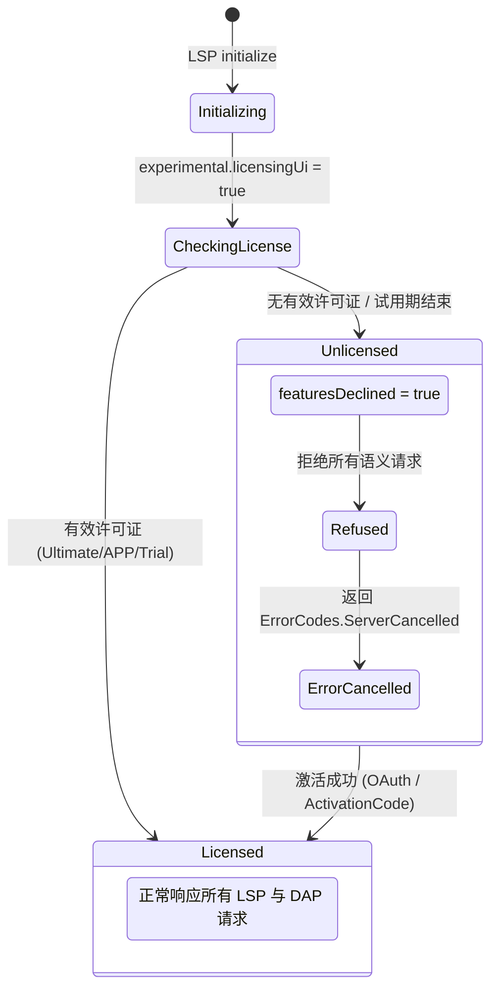

# IntelliJ Language Server (intellij-server) 架构、协议与逆向深度研究报告

本报告综合分析了 JetBrains 官方 Neovim 客户端 (`JetBrains/intellij-lsp.nvim`) 及社区两大深度集成与逆向项目 (`gipo355/nvim-intellij-lsp`、`AlexandrosAlexiou/intellij-server.nvim`) 的源码实现、调试记录与逆向手记，对 JetBrains Headless LSP/DAP 服务端（`intellij-server`，Build `263.7084.0`）的底层架构、协议交互、调试器时序与已知缺陷治理进行深度解构。

**OMP 适用边界（2026-11-02 审查）**：本报告包含上游与 Neovim 客户端经验，不能整体视为本插件已实现或已实测能力。GUI 补全、模板、高亮与 Lua 数据处理按宿主需求取舍；OMP 继续复用原生 LSP、debug、bash 与 service。功能及验收以 [TODO.md](./TODO.md) 为准，未决结论见 [RESEARCH.md](./RESEARCH.md)，本次仅修正文档。

---

## 目录

1. [架构全景与二进制运行时剖析](#1-架构全景与二进制运行时剖析)
2. [进程管理、网络模型与排他文件锁](#2-进程管理网络模型与排他文件锁)
3. [商业授权体系、EULA 校验与状态机](#3-商业授权体系eula-校验与状态机)
4. [LSP 协议矩阵、私有扩展命令与载荷结构](#4-lsp-协议矩阵私有扩展命令与载荷结构)
5. [DAP 调试器架构、测试引擎与时序](#5-dap-调试器架构测试引擎与时序)
6. [多构建工具支持、三层 JDK 与外部库模型](#6-多构建工具支持三层-jdk-与外部库模型)
7. [14 项上游缺陷、实测陷阱与工程级解决方案全览](#7-14-项上游缺陷实测陷阱与工程级解决方案全览)

---

## 1. 架构全景与二进制运行时剖析

### 1.1 分发体系、平台矩阵与哈希校验

服务端二进制由 JetBrains 官方 CDN 托管分发。VS Code 市场上的扩展（`JetBrains.intellij-server`）仅为 1.4 MB 的下载器垫片（Shim），实际运行时均在首次启动时拉取解压约 1 GB 的独立服务端归档。

- **官方 CDN 下载模板**：

  ```text
  https://download.jetbrains.com/language-server/intellij-server/{version}/intellij-server-{version}{arch_suffix}.{ext}
  ```
- **多平台归档矩阵 (Build `263.7084.0` / IntelliJ 2026.3 分支)**：
  | 操作系统    | 架构   | 架构后缀 (`arch_suffix`) | 扩展名 (`ext`) | 归档格式 | 归档字节数  | SHA-256 校验和                                                     |
  | :---------- | :----- | :----------------------- | :------------- | :------- | :---------- | :----------------------------------------------------------------- |
  | **macOS**   | ARM64  | `-aarch64`               | `.sit`         | 标准 ZIP | 378,499,345 | `ea728da71e3511939b4cb8e4af4aa5e4dda6e0ab7c2bdd1830a5d110bdf2bbec` |
  | **macOS**   | x86_64 | `""` (空)                | `.sit`         | 标准 ZIP | 380,456,870 | `3b31cd867ce0e361bfc763ba78cf4fa1dcb1a5324b97c817a0ec045532278420` |
  | **Linux**   | ARM64  | `-aarch64`               | `.tar.gz`      | Gzip TAR | 385,782,431 | `d5df0980acc4eeb35b1e76227caa62639fcda188649064d17b5b0de1077b38c0` |
  | **Linux**   | x86_64 | `""` (空)                | `.tar.gz`      | Gzip TAR | 386,777,831 | `3842f2f457e29e58cd9c37a97482b28255d598a2ff142075753d947206c0b922` |
  | **Windows** | ARM64  | `-aarch64`               | `.win.zip`     | 标准 ZIP | 361,354,713 | `2ce197ad10684d55334c5611433c1479ccb574e52d78e41d023e3f2dd0be4704` |
  | **Windows** | x86_64 | `""` (空)                | `.win.zip`     | 标准 ZIP | 381,741,020 | `d84629cbdd79d58f021a15a75f05018518398906519a0e830df6f8a8d515e286` |

_注：JetBrains 对 macOS 归档历史沿用 `.sit` 后缀，对 Windows 使用 `.win.zip` 后缀，解压工具按标准 ZIP 算法处理即可。_

### 1.2 二进制目录结构与产品代码识别 (`ILS` vs `LS`)

解压后根目录包含：
- `bin/`：原生启动器（`intellij-server`、`intellij-server.exe`）、启动配置 `intellij-server.vmoptions`、预热脚本 `warmup.py`。
- `jbr/`：绑定的 JetBrains Runtime，运行服务端本体；具体 Java 版本以所选分发包为准。两份历史报告的 Java 21 / JBR 25 记录尚需按包核对。
- `lib/`：平台核心类库（`intellij.platform.*.jar`、`language-server.*.jar`）。
- `plugins/`：分析插件集（`java/`、`kotlin/`、`lombok/`、`spring/`、`bazel/`）。
- `product-info.json`：产品元数据。

**产品代码鉴别**：
- `productCode = "ILS"`：商业分发版（Java + Kotlin + Spring 完整语言服务器）。
- `productCode = "LS"`：开源分支构建的 `kotlin-lsp`。两者启动器文件名完全一致，但 `LS` 版本缺失 `java.lsp` 与 `spring.lsp` 插件，将其配置为 Java LSP 会出现无报错但完全不响应 Java 符号的静默失败。

### 1.3 启动器机制与 JVM 参数注入 (`IJ_JAVA_OPTIONS`)

- **堆内存默认瓶颈**：`bin/intellij-server.vmoptions` 默认硬编码 `-Xmx2048m` 与 `-XX:ReservedCodeCacheSize=512m`。在依赖库超过 100 个的大型项目上，2 GB 堆空间会导致垃圾回收（GC）频率飙升，代码补全延迟从 500ms 恶化至数秒，甚至因超出系统限制被 OOM-Killer（退出码 137）直接杀死。
- **参数注入规则**：原生二进制启动器**不接收任何命令行形式的 `-Xmx` 或 JVM 参数**（CLI 参数由内部 Clikt 库严格校验）。启动器在初始化 JVM 前只读取环境变量 `IJ_JAVA_OPTIONS`。客户端若要分配更多内存，必须配置：

  ```bash
  export IJ_JAVA_OPTIONS="-Xmx4096m -XX:ReservedCodeCacheSize=1024m"
  ```

  启动器会将环境变量内容追加在 `.vmoptions` 之后传入 JBR，使大内存参数生效。
- **标准输出污染防护 (`IJ_LAUNCHER_DEBUG`)**：
  若父进程环境中遗留了 `IJ_LAUNCHER_DEBUG`，启动器会在拉起 JVM 期间直接向 `stdout` 输出明文调试日志。在 `--stdio` 模式下，这些非 JSON-RPC 字符会直接破坏客户端协议解析器。**客户端 spawn 进程前必须显式将 `IJ_LAUNCHER_DEBUG` 置空或剔除**。

### 1.4 完整环境变量矩阵

| 环境变量                            | 可选值 / 格式                                                   | 用途与后果                                                            |
| :---------------------------------- | :-------------------------------------------------------------- | :-------------------------------------------------------------------- |
| `IJ_JAVA_OPTIONS`                   | JVM 参数字符串                                                  | 唯一可向服务端 JBR 注入堆内存（`-Xmx`）与系统属性（`-D`）的通道。     |
| `IJ_LAUNCHER_DEBUG`                 | 任意字符串                                                      | **必须清除**。若非空，明文日志污染 stdout 破坏 JSON-RPC 协议帧。      |
| `INTELLIJ_REGION`                   | `europe`, `americas`, `apac`, `china`, `middle_east`, `oceania` | 配置合规与遥测路由；非法值会导致服务端在启动初期 crash。              |
| `INTELLIJ_DATA_SHARING`             | `none`, `anonymous`, `full`, `test`                             | 遥测级别；生产与自动化环境强制推荐设为 `none`。                       |
| `INTELLIJ_SERVER_EULA_PERSISTENCE`  | `true`, `false`                                                 | 若设为 `false`，禁止服务端写入本地偏好文件 (`java.util.prefs`)。      |
| `MAVEN_ARGS` | Maven CLI 参数字符串 | 按工程显式配置导入参数；跳过检查插件需有该工程失败证据与明确选择，禁止全局强制注入。 |
| `INTELLIJ_SERVER_LICENSE` / `_FILE` | 激活文本 / 文件路径                                             | 覆盖默认凭据存储，非交互式直接指定商业许可证。                        |

---

## 2. 进程管理、网络模型与排他文件锁

### 2.1 启动模式与参数定义

服务端原生提供两种通信模式：
```text
1. Stdio 模式 (独立进程单工程)
   intellij-server --stdio --system-path <dir> --eula <hash>

2. Socket 守护模式 (常驻进程多工程)
   intellij-server --socket=<host>:<port> --multi-client --system-path <dir> --eula <hash>
```

### 2.2 `--multi-client` 底层实质与并发约束

- **并发语义陷阱**：`--multi-client` 标志表示单个 `intellij-server` 守护进程能够通过套接字挂载**多个不同的工程目录**（Multi-Project）。
- **单项目独占锁**：服务端内部工程模型对单个项目根目录具有严格的排他锁保护。**绝对不支持两个客户端连接同时操作同一个项目根路径**。向同一个工程发送第二个 `initialize` 请求时，服务端抛出：

  ```text
  lock hold by current process ... No locks available
  ```

  因此，多个客户端进程（如多个终端或多个 Agent）并发访问同一项目时，必须通过中间代理层串行化或进行端口多路复用，不可直接让两个进程并发启动同一目录。

### 2.3 RocksDB 索引目录排他文件锁 (`LOCK`) 与槽位治理

服务端使用 RocksDB 持久化 AST 索引与符号表。RocksDB 会在 `--system-path` 目录下创建 `LOCK` 文件并持有操作系统级排他锁。
若两次会话竞争同一个 `--system-path`，后启实例直接抛出 `RocksDBException: While lock file ...: Resource temporarily unavailable`。

- **官方 8-slot 槽位算法 (`launch.lua`)**：
  为避免多会话冲突，JetBrains 官方 Neovim 客户端设计了基于哈希的动态槽位轮换机制：
  1. 取项目根路径绝对地址计算 SHA-256 摘要前 16 位：`key = sha256(root_dir):sub(1, 16)`。
  2. 预备 8 个存储槽位：Slot 1 映射为 `cache/intellij-lsp/<key>/`，Slot $N$ (2..8) 映射为 `cache/intellij-lsp/<key>-<N>/`。
  3. 每个槽位内记录 `nvim.pid` 文件。启动时从 Slot 1 遍历到 Slot 8：通过 `kill(pid, 0)`（Windows: `OpenProcess`）探测槽位持有者是否存活。
  4. 遇到第一个空闲槽位或持有者已死亡的槽位，立即写入当前 PID 占位并将其作为本次启动的 `--system-path`。

- **社区租约自毁模型 (`connection.lua`)**：
  在常驻 Socket 模式下，客户端通过 `socket-server.spawn.lock` 保证单例启动，将各自 PID 登记在 `socket-clients/<pid>`。各客户端退出时注销自身租约；最后一个注销租约的客户端负责发送终止信号回收后台常驻服务端。

### 2.4 跨平台进程树级联销毁 (Teardown)

进程清理先验证服务实例身份及所有权，再确认所有工程均无活动消费者。共享 Gradle daemon 的存活本身不构成泄漏，attach 的外部 JVM 始终受保护。
- Unix 进程组信号和 Windows `taskkill /T /F` 仅作为已证明独占拥有的进程树清理手段；不能依据父子关系推断所有后代均可终止。
- 显式安全 stop / restart 见 `TODO.md`；活动租约检查与启停、缓存清理共用生命周期锁，退出后核对端口和 owner 元数据。

---

## 3. 商业授权体系、EULA 校验与状态机

### 3.1 EULA 校验机制的演进

- **旧版协议 (<= Build 263.2689)**：
  服务端在 `initialize` 请求时检查 `initializationOptions.eulaHash`。若未传或不符，返回 JSON-RPC 错误：`RequestFailed: Bundled license agreement (EULA.txt) is not accepted`。
- **现行协议 (>= Build 263.3533)**：
  启动器可在进入 LSP 前检查 EULA，未接受时以退出码 11 结束；具体是否已有持久化接受记录需按当前包核实。传递当前 hash 的前提是用户明确接受实际协议。
- **哈希计算算法**：
  读取服务端解压目录下的 `EULA.txt` 文件，计算其 SHA-256 哈希，截取**前 16 位小写十六进制字符**：
  $$\text{hash} = \text{SHA256}(\text{EULA.txt})[0..15]$$
  例如：`shasum -a 256 EULA.txt | cut -c1-16`。哈希不一致意味着用户尚未同意新版协议，需重新确认。

### 3.2 商业授权状态机与协议交互

自 `1.0` 版本起，服务端集成完整 JetBrains 授权验证系统，要求具备 IntelliJ IDEA Ultimate、All Products Pack 订阅或 30 天试用期。



- **协议握手声明**：客户端在 `initialize` 时必须传 `capabilities.experimental.licensingUi = true`。此声明告知服务端由客户端托管授权展示，抑制服务端弹出阻塞式原生弹窗。
- **授权协议方法集**：
  - `jetbrains/licensing/state` (Server $\to$ Client Notification)：推送当前许可状态结构体。
  - `jetbrains/licensing/state/get` (Client $\to$ Server Request)：主动拉取许可详情。
  - `jba/login` / `jba/logout`：触发 JetBrains Account 网页 OAuth 授权。
  - `trial/startAnonymous`：启动 30 天匿名本地试用。
  - `activationCode/use`：输入离线激活码。
  - `licenseServer/add`：配置私有/企业许可证服务器地址。
- **未授权保护拦截**：当处于无授权或试用过期状态时，服务端能正常完成 LSP `initialize` 握手并返回 capabilities，但内部将状态置为 `featuresDeclined = true`。**所有后续代码语义请求（补全、跳转、诊断、反编译）均会直接报错中断**，错误信息为：
  `ErrorCodes.ServerCancelled (-32800): "Request refused: no active JetBrains license"`。

---

## 4. LSP 协议矩阵、私有扩展命令与载荷结构

### 4.1 核心支持与未支持能力对照

根据生产代码库全量探测结果整理：

| 能力分类       | 服务端原生支持的能力 (Capabilities)                                                                                                                                        | 服务端不支持的能力 (Omitted)                                          |
| :------------- | :------------------------------------------------------------------------------------------------------------------------------------------------------------------------- | :-------------------------------------------------------------------- |
| **代码导航**   | `definitionProvider`, `typeDefinitionProvider`, `implementationProvider`, `declarationProvider`, `referencesProvider`, `documentSymbolProvider`, `workspaceSymbolProvider` | `documentHighlightProvider` (无高亮范围匹配)                          |
| **重构与修改** | `renameProvider` (含 `prepareProvider`), `codeActionProvider` (`quickfix`, `source.organizeImports`, `source.fixAll`), `documentFormattingProvider`                        | `documentRangeFormattingProvider`, `documentOnTypeFormattingProvider` |
| **辅助阅读**   | `hoverProvider`, `signatureHelpProvider`, `inlayHintProvider`, `semanticTokensProvider`, `foldingRangeProvider`, `colorProvider`                                           | `selectionRangeProvider`                                              |
| **执行与透镜** | `codeLensProvider` (支持 `resolveProvider`), `executeCommandProvider`                                                                                                      | -                                                                     |
| **层级分析**   | `callHierarchyProvider`, `typeHierarchyProvider` (注：测试源码集调用存在漏扫)                                                                                              | -                                                                     |

### 4.2 8 大核心私有命令完整数据载荷定义 (`workspace/executeCommand`)

#### 1. `start_debug_server`

在服务端内部启动 DAP 调试 TCP 监听器。
- **请求入参**：`[]` 或 `[ "<root_uri>" ]`
- **返回结果**：`number`（例如 `54321`，即服务端开放的本地 TCP 端口号）。

#### 2. `exportWorkspace`

将工程完整构建模型与物理文件依赖全量导出。
- **请求入参**：`[ "<target_directory_path>" ]`
- **返回结果**：`void`。服务端会在目标路径下生成 `workspace.json`。
- **`workspace.json` 结构定义**：

  ```json
  {
    "projects": [
      {
        "name": "my-module",
        "rootUrl": "file:///path/to/module",
        "jdk": { "name": "corretto-21", "homePath": "/path/to/jdk" },
        "sourceRoots": [
          { "url": "file:///path/to/src/main/java", "rootType": "java-source" },
          { "url": "file:///path/to/src/test/java", "rootType": "java-test" }
        ],
        "dependencies": [
          {
            "type": "library",
            "name": "org.springframework.boot:spring-boot:3.2.0",
            "classes": [ "jar:file:///path/to/spring-boot-3.2.0.jar!/" ],
            "sources": [ "jar:file:///path/to/spring-boot-3.2.0-sources.jar!/" ]
          }
        ]
      }
    ]
  }
  ```

#### 3. `decompile`

反编译或提取外部类库源文件。
- **请求入参**：`[ "<virtual_uri>" ]`（例如 `jar:file:///path/to.jar!/com/foo/Bar.class` 或 `jrt:/java.base/java/lang/String.class`）
- **返回结果**：

  ```json
  {
    "code": "package com.foo;\n\npublic class Bar { ... }",
    "language": "java"
  }
  ```

#### 4. `intellij.java.resolveClassDocument`

根据类全限定名反查源文件物理地址。
- **请求入参**：`[ { "fqn": "com.example.Application" } ]`
- **返回结果**：`{ "uri": "file:///path/to/src/main/java/com/example/Application.java" }`。

#### 5. `intellij.java.resolveBuildToolLaunch`

检测构建工具（Gradle）是否具备直接编译运行该类的能力。
- **请求入参**：`[ { "uri": "<file_uri>", "mainClass": "com.example.Application" } ]`
- **返回结果**：

  ```json
  {
    "supported": true,
    "tool": "gradle",
    "moduleName": "app.main",
    "scopeClassPaths": [ "/path/to/build/classes/java/main" ]
  }
  ```

#### 6. `intellij.java.resolveBuildCommand`

获取编译指定源文件所在的模块的构建命令。
- **请求入参**：`[ { "uri": "<file_uri>" } ]`
- **返回结果**：

  ```json
  {
    "supported": true,
    "tool": "maven",
    "cwd": "/path/to/project",
    "command": [ "/path/to/mvn", "compile", "-q" ]
  }
  ```

#### 7. `intellij.java.resolveLaunch`

计算脱离构建工具直接拉起 JVM 调试所需的全部类路径与启动参数。
- **请求入参**：`[ { "uri": "<file_uri>", "cwd": "<working_dir>" } ]`
- **返回结果**：

  ```json
  {
    "javaExec": "C:\\Program Files\\Java\\jdk-21\\bin\\java.exe",
    "workingDirectory": "F:\\projects\\demo",
    "classpath": [
      "F:\\projects\\demo\\target\\classes",
      "C:\\Users\\user\\.m2\\repository\\org\\slf4j\\slf4j-api\\2.0.9\\slf4j-api-2.0.9.jar"
    ],
    "modulePath": [],
    "moduleName": null,
    "moduleContentPaths": [ "F:\\projects\\demo\\target\\classes" ],
    "vmArgs": [ "-Dfile.encoding=UTF-8" ]
  }
  ```

#### 8. `intellij.jvm.resolveTestLaunch`

计算单元测试专有启动参数与测试框架依赖。
- **请求入参**：`[ { "uri": "<test_file_uri>", "testIds": [ "com.example.DemoTest" ] } ]`
- **返回结果**：

  ```json
  [
    {
      "mainClass": "com.intellij.rt.junit.JUnitStarter",
      "args": [ "-ideVersion5", "com.example.DemoTest" ],
      "runtimeClasspath": [
        "/path/to/intellij-server/plugins/java/lib/intellij.java.rt.jar",
        "/path/to/intellij-server/plugins/junit/lib/junit-rt.jar"
      ]
    }
  ]
  ```

### 4.3 动态配置拉取 (`workspace/configuration`)

服务端不接收在 `initialize` 时一次性传入的静态 settings，而是在握手完毕后通过 `workspace/configuration` 向客户端反向拉取两级命名空间：
1. `intellij.*`：运行环境与构建工具设置（`jdkForSymbolResolution`、`buildTool`、`region`、`dataSharing`）。
2. `jetbrains.*`：语言特性与 Inlay Hints 开关。
   _注意：Java 与 Kotlin 的 Inlay Hints 键名包含字面空格，如 `jetbrains.java.hints.settings.method parameter`，序列化时必须严格保持键名包含空格。_

---

## 5. DAP 调试器架构、测试引擎与时序

### 5.1 架构拓扑与适配器标识符限制

服务端内部通过 `com.jetbrains.dap.jvm.JvmDebuggerAdapter`（挂载在 `language-server.dap.jvm.jar` 中）提供完整的 JDI 调试封装。

```
[Agent / DAP Client]
        │
        ├─ 1. LSP: workspace/executeCommand("start_debug_server")
        │   └─ Returns TCP Port (e.g. 54321)
        │
        ├─ 2. Connect TCP Socket to 127.0.0.1:54321
        │
        ├─ 3. DAP initialize { adapterID: "intellij_debugger" }
        │   └─ [CRITICAL]: Must be "intellij_debugger" (or "intellij_jvm")
        │
        ├─ 4. DAP launch { ... }  OR  attach { port: 5005, hostName: "127.0.0.1" }
        │
        └─ 5. JDI Session Management & Event Dispatching
```

- **适配器 ID 硬校验**：DAP 握手时的 `adapterID` **必须声明为 `intellij_debugger` 或 `intellij_jvm`**。若客户端传入其他自定义名称（如 `intellij`、`java`），服务端会直接拒绝：`"No debugger adapter found for given adapter id"`。

### 5.2 启动增强流水线 (Enrichment Pipeline)

客户端在拉起调试前，通过以下流水线对参数进行补全富化：
```text
[用户或 Agent 输入: class 或 file]
         │
         ▼
    是否存在 file 路径?
    ├─ 否 ──► intellij.java.resolveClassDocument { fqn = mainClass } ──► 拿到源文件 URI
    └─ 是 ──► 使用已有 file URI
         │
         ▼
    判定启动模式 (Launcher Selection)
    ├─ "gradle" ──► intellij.java.resolveBuildToolLaunch
    │                └─ 生成 buildToolTarget 结构，调试生命周期绑定 Gradle Daemon
    │
    └─ "jvm" ─────► 是否需要预构建?
                     ├─ 是 ──► intellij.java.resolveBuildCommand ──► 异步跑编译命令
                     └─ 否 ──► 直接执行
                               │
                               ▼
                     intellij.java.resolveLaunch
                     ├─ classpath: 聚合项目类路径与第三方 JAR
                     ├─ modulePath & moduleName: 处理 JPMS 模块化定义
                     ├─ moduleContentPaths: 补全 --patch-module 规避分包限制
                     ├─ javaExec: 绑定项目对应的 JDK java.exe
                     └─ vmArgs: 补充参数
```

### 5.3 单测执行模型与 TeamCity 服务协议

服务端跑单元测试时不走外部 Maven Surefire 或 Gradle Test 任务，而是直接调用内置的 `com.intellij.rt.junit.JUnitStarter`，以 `console = "none"` 运行。
测试运行过程中，标准输出流中会交错输出 **TeamCity 专有服务状态行**：
```text
##teamcity[testStarted name='testCalculation()' locationHint='java:test://com.example.DemoTest/testCalculation']
##teamcity[testFailed name='testCalculation()' message='expected: <2> but was: <3>' details='org.opentest4j.AssertionFailedError...']
##teamcity[testFinished name='testCalculation()' duration='14']
```

- **OMP 适用边界**：当前插件保留测试输出与真实退出码。社区客户端的诊断转换只作为实现参考；单个正则不足以处理服务消息转义、分块与多线程输出，也不应抹除唯一的原始错误证据。

### 5.4 时序死锁与非平稳断连陷阱

1. **`attach` 与 `configurationDone` 时序死锁**：
   - DAP 客户端应处理 `initialized` 事件并完成断点配置与 `configurationDone`；不能把“等待 attach 响应后才发送配置完成”当作通用前提。
   - IntelliJ 服务端逻辑：JDWP 底层在完成握手确认前，**强制要求先收到 `configurationDone` 信号**。如果不发，服务端的 `attach` 响应永远挂起直到超时。
   - **解决规约**：针对 IntelliJ 适配器，客户端在收到 `initialized` 事件时，必须主动提前将 `configurationDone` 发送给服务端，打破时序死锁。
2. **`disconnect` 后的 TCP 异常 EOF 丢弃**：
   - 服务端在处理完 DAP `disconnect` 并释放 JVM 后，其内部协程会立即关闭 TCP 套接字。
   - 经常出现客户端尚未读取完 JSON-RPC 的 `disconnect` 响应，底层的 TCP Socket 就收到了 `EOF`（`ECONNRESET` 或 `close`），导致客户端抛出“调试服务意外退出”的伪错误。
   - **解决规约**：仅在明确的正常 teardown 关闭路径接受 EOF；清理超时、错误响应和异常断连继续报告失败，禁止把所有 shutdown 期间的关闭视为成功。

---

## 6. 多构建工具支持、三层 JDK 与外部库模型

### 6.1 三层 JDK 解析模型

服务端在工程运行期明确区分三个层次的 JDK 配置：
1. **Server Process JVM**：运行 `intellij-server` 进程本体的 JRE，强制使用自带的 `jbr/`，宿主无需关心。
2. **Import Runner JVM**：执行 Maven 依赖下载或运行 Gradle Daemon 的环境。可通过 `JB_MAVEN_JAVA_HOME` 系统属性或 `$JAVA_HOME` 显式覆盖。
3. **Project SDK**：用于工程源码语法高亮、索引构建和类路径解析的编译目标环境。
   - Maven / Gradle：从构建脚本自动推断。当未匹配到时，扫描本地标准路径（`~/.jdks`、`/Library/Java/JavaVirtualMachines`、`C:\Program Files\Java`），默认绑定检测到的**最高版本**（易出现项目需要 Java 17 但被本地安装的 Java 25 绑架的现象，需显式声明 `defaultSdk` 锁定）。
   - JPS (`.idea`)：从 `.idea/misc.xml` 中的 `project-jdk-name` 属性强行读取。JPS 模式不认路径，只认 JDK 名称（如 `zulu-21`、`temurin-17`）。

### 6.2 外部依赖库结构虚拟化 (`jar://` 与 `jrt://`)

服务端不提供文件树浏览协议接口。要还原 IDE 中的“外部依赖库”（External Libraries）目录树：
1. **全量元数据导出**：调用 `exportWorkspace <dir>` 拿到 `workspace.json`，遍历其中所有的依赖 JAR 与 JDK 源码模块。
2. **本地轻量级索引**：客户端不调用服务端，直接利用本地操作系统工具（`unzip -Z1`、`tar -tf` 或针对 JDK 运行时镜像的 `jimage list`）在本地以线程池并发提取归档文件列表。
3. **按需反编译加载**：虚拟协议路径采用 `jar://file:///path/to.jar!/entry.class` 与 `jrt:/java.base/java/lang/String.class`。当在编辑器中打开此类文件时，拦截只读缓冲区并通过 `decompile` 命令向服务端获取反编译代码文本注入缓冲区。

---

## 7. 14 项上游缺陷、实测陷阱与工程级解决方案全览

下表保留 14 类上游或社区客户端问题。前六项等 GUI/Neovim 特有处理不直接转为 OMP 开发任务；涉及授权、清理和错误契约的建议按本次审查边界执行。

| #      | 子系统                      | 现象 / 缺陷描述                                                             | 底层根因分析                                                                                                                     | 工程级最佳解决方案                                                                                                                                      |
| ------ | --------------------------- | --------------------------------------------------------------------------- | -------------------------------------------------------------------------------------------------------------------------------- | ------------------------------------------------------------------------------------------------------------------------------------------------------- |
| **1**  | **补全 (Completion)**       | 补全代码时光标跳变，插入重复字符（如 `Ap\|p`）。                            | 服务端早期返回空 `textEdit` 并绑定 `completion.apply` 命令。通用客户端先将 label 插入缓冲区，随后执行服务端命令时二次叠加编辑。  | **无害自替换编辑**：在拦截层将项的 `textEdit` 替换为将“当前已键入前缀替换为其自身”的无害操作，让编辑器不修改文本，由服务端的后续 `applyEdit` 完整生效。 |
| **2**  | **补全 (Completion)**       | 接受同名重载或同名类（如多个 `List`）时，永远插入最后查看的项。             | 客户端在重写 snippet 补全缓存时简单以项的 `label` 作为 Map 键，发生散列冲突。                                                    | 将缓存键改为由原编辑区起始位置坐标与文本内容联合哈希的复合键（`edit_key`）。                                                                            |
| **3**  | **代码模板 (Templates)**    | 展开 Live Templates（`sout`、`psvm`）时代码缩进完全乱套。                   | 服务端模板文本硬编码了绝对 4 空格缩进，完全无视项目的 `.editorconfig` 或缩进设置。                                               | 解析模板文本，将行首的绝对 4 空格基线按层级换算为相对制表符 `\t`，交由客户端本地排版引擎按 `shiftwidth` 展开。                                          |
| **4**  | **语义标记 (Tokens)**       | 嵌套类导入语句（如全限定类路径）的高亮颜色在类与包名间随机频闪。            | 服务端为嵌套表达式返回了完全重叠的区间片段（如 `[7, 44)` 为类，`[7, 28)` 为包名）。客户端标记树优先级相同时渲染顺序不稳定。      | **区间栈覆盖算法 (Cover Algorithm)**：对单行 Token 按起始升序、结束降序排序，使用栈计算无重叠的不相交覆盖区间，再重新编码输出。                         |
| **5**  | **语义标记 (Tokens)**       | 打开项目初期语法高亮极度粗糙，索引完毕后高亮永不更新。                      | 服务端在索引构建期返回粗糙的 stub 标记，索引完成时**不主动发送** `workspace/semanticTokens/refresh`。                            | 客户端监听 `$/progress`，捕获标题为 `"Indexing"` 且状态为 `"end"` 时，主动触发客户端重新全量拉取语义标记。                                              |
| **6**  | **代码诊断 (Diagnostics)**  | Neovim 0.12 在收到诊断失败时报未捕获 Lua 错误崩溃。                         | 服务端返回的错误报文中包含 `data: null`，解码为 `vim.NIL`，Neovim 诊断分发逻辑强行索引 `err.data` 引发空指针。                   | 在响应拦截层强行做数据清洗：若 `err.data == vim.NIL` 则将其设为 `nil`。                                                                                 |
| **7** | **授权拒绝与重试** | 无授权时语义请求被拒绝，特定客户端可能循环重试。 | 授权失败与通用取消需要区分，不能仅凭错误码判定。 | 插件提供真实授权状态；OMP 原生客户端负责其诊断重试策略，不在插件另建循环。 |
| **8**  | **JSON-RPC 序列化**         | 服务端抛出 `Expected JsonArray` 或 `expected a JSON object` 反序列化失败。  | 弱类型语言客户端将空哈希表 `{}` 序列化为 `[]`，而 JetBrains Kotlinx Serialization 对空对象结构强类型校验。                       | 严格做空值清洗：空对象字段强制使用强类型空字典，空列表字段使用强类型空数组，禁止混淆。                                                                  |
| **9** | **导入模型异常** | 历史记录中导入失败后依赖模型为空。 | 零依赖也可能合法，尚不足以单独确认缓存损坏。 | 先展示导入根因与模型证据；禁止按零库自动删缓存，清理经显式确认并保护活动工程。 |
| **10** | **进程清理** | 服务退出后可能仍有子进程。 | 共享 daemon 与独占进程需分别确认所有权。 | 仅回收已证明独占拥有的目标，保护其他工程与外部 attach JVM。 |
| **11** | **共享服务驻留** | 最后一个客户端离开后服务可能继续运行。 | 驻留策略与泄漏应区分。 | 保留既有 idle timeout；提供受租约保护的显式启停，自动轮替另行预研。 |
| **12** | **Maven 导入耗时或失败** | 部分工程导入可能执行耗时检查插件。 | 是否触发插件取决于工程配置，需要日志证据。 | 用工程级导入环境显式选择参数，保留原始构建语义，禁止全局强制跳过检查。 |
| **13** | **JDI 调用栈越界** | 历史 `stackTrace` 记录出现 `Index 128 out of bounds for length 65`。 | 所列字节码与浅层读取记录的条件尚未对齐。 | 保留失败响应与真实帧；验证继续运行及断开；分页、阈值和根因继续研究，禁止合成成功帧。 |
| **14** | **Android 构建推导** | 历史 AGP 样例不存在 `debugClasses`。 | 普通 JVM sourceSet 任务推导不匹配该 Android 工程。 | 构建、安装交给 OMP bash 与 Android 工具；调试走 JDWP attach，适配器预构建设 `build: false`；不透明改写 task。 |
