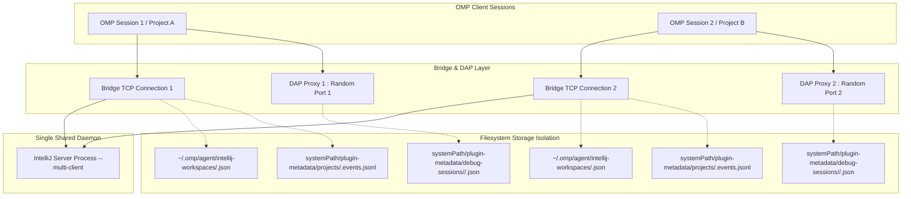

# DAP 调试代理与多工作区隔离规范

## 1. 调试适配器与启动配置

### 1.1 适配器预设与参数规则

OMP 原生 `debug` 工具的 `launch` 操作接受 `program`、`args`、`adapter`、`cwd` 与 `timeout` 等固定字段（`arguments` 仅用于 `custom_request`）。插件通过配置预设由 `launchDefaults` 注入 `testMode` 或 `buildTool`，统一经由同一个 stdio 调试代理分发：

- **显式选择与覆盖合并**：调用方依据运行场景显式指定 `adapter`（自动发现仅凭文件扩展名与工程标记匹配，无法区分同一源码的主类、测试与 Gradle 运行模式）。项目 `.omp/dap.json` 可按字段增量覆盖插件根目录的 `launchDefaults` 与 `attachDefaults`，显式调用参数 `program`、`cwd`、`args` 由 OMP 组装进最终请求（保持布尔值与字符串数组类型，`testMode` 等布尔选项不传字符串 `"true"`）。
- **类型与互斥约束**：
  - `testMode`、`build`、`stopOnEntry`、`noDebug` 为布尔值；`args`、`vmArgs`、`gradleArgs` 为字符串数组。
  - `buildTool` 允许省略（交由 ILS 按所属模块选择原生构建与启动链路）或设为 `"gradle"`。
  - `testMode: true` 与 `buildTool: "gradle"` 互斥；`gradleArgs`、`projectPath`、`sourceSet` 仅用于 Gradle 模式（后两项须为非空字符串）。非法组合在建立 LSP 连接或构建前直接返回 DAP 失败响应。
  - 原生 JVM 启动始终包含前置构建流程，不提供跳过构建的参数，`build:false` 直接返回不支持。
  - 通用 `intellij` 预设不强行向非 JVM 目标注入 JVM 专属的 `console`、`build` 或 `stopOnEntry` 默认项：JVM 路由自带 `internalConsole` 与入口暂停，Android 构建行为由 `android.target.build` 控制。

在 `.omp/dap.json` 中为 Gradle 预设附加构建参数的配置示例：

```json
{
  "adapters": {
    "intellij-gradle": {
      "launchDefaults": {
        "gradleArgs": ["-PengineeringMessage=agent"]
      }
    }
  }
}
```

### 1.2 会话生命周期与附加探测

- **会话并发模型**：OMP debug manager 在同一时刻维护一棵根调试会话树；多个适配器名称不改变单一 manager 的会话限制。多工程隔离机制保证多个客户端进程与共享 ILS 守护进程之间互不干扰。
- **入口暂停与退出码**：入口暂停通过异步 `stopped` 事件送达（OMP 从发出 `launch` 前开始监听；构建耗时较长时 `launch` 可先返回 `running`，启动就绪后再转为 `stopped`）。`terminated` 事件仅代表会话终止，部分原生 Gradle 会话不上报 `exited`/`exitCode`，此时结合构建日志与测试报告判定结果。
- **Windows 控制台 UTF-8 编码**：Java 18+ 在 Windows 下默认将标准输出/错误流编码设为系统代码页（如 GBK）。代理对构建与启动 JVM 注入以下参数，并在 Node 流消费端使用 `string_decoder.StringDecoder('utf8')` 解码跨 chunk 多字节字符：

  ```ts
  '-Dfile.encoding=UTF-8',
  '-Dstdout.encoding=UTF-8',
  '-Dstderr.encoding=UTF-8',
  ```

- **JDWP 附加与 `suspend=y` 就绪探测**：普通 JVM attach 须显式指定 `adapter: "intellij"` 与 `host`/`port`。对于挂起等待调试器的外部进程，使用回环端口探测与 `intellij/threadDump` 轮询判断就绪，不依赖 stdout 日志。扩展端点的专属参数仅透传给后端。
- **超时预算与配置文件**：工具 `timeout` 单位为秒（受 OMP 限制在 `5–300` 秒及外层预算内）；普通 JVM `attachDefaults.timeout` 控制 DAP 连接超时，Android `timeoutMs` 控制 JVM 启动超时。插件注册清单来自 `.omp-plugin/marketplace.json`（加载时物化为根目录 `.dap.json`），项目定制统一写在 `.omp/dap.json`（宿主要求参见 [OMP debug 文档](omp://tools/debug.md) 与 [marketplace 安装契约](omp://skills/authoring-marketplaces.md)）。

---

## 2. JSON-RPC 分帧协议 (`src/shared/protocol.ts`)

OMP Bridge 与 DAP Proxy 共用流式分帧解析器 `frameParser`，采用滑动缓冲区与状态机分离报头与载荷，遵循标准 LSP/DAP `Content-Length` 协议：

```
+--------------------------------------------------------+
| Content-Length: <length>\r\n                           |
| \r\n                                                   |
+--------------------------------------------------------+
| JSON Body (length 字节, UTF-8 编码)                    |
+--------------------------------------------------------+
```

- **报头限制**：上限 8192 字节（`8 KiB`），超过上限未遇到 `\r\n\r\n` 抛出 `Invalid LSP header`。
- **载荷限制**：须满足 `1 <= length <= 67108864`（64 MiB），越界抛出 `Invalid LSP frame length`。
- **分片拼装**：接收数据块时通过 `Buffer.subarray` 切片缓存，整帧收齐后调用一次 `Buffer.concat(parts, length)` 拼装，支持跨 chunk 报头与多帧粘包场景。
- **协议错误**：帧或 JSON 无法解析时关闭相应连接、拒绝待处理请求，并通过会话清理路径释放资源。

---

## 3. 多工作区隔离与守护进程管理

多个工作区复用同一个 `--multi-client` 后台 ILS 进程与 `systemPath`，按 64 字符 SHA-256 工程 ID 隔离配置、事件日志与调试控制文件；索引根目录通过握手响应中的 `capabilities.experimental.indexDir` 指定。



### 3.1 工程身份与路径哈希 (`canonicalizeProject`)

- 归一化路径分隔符与 Windows 盘符，并探测目标目录的文件系统大小写敏感特性：大小写不敏感路径按小写折叠后计算 SHA-256；大小写敏感路径按 `case-sensitive\0` 域前缀加保留大小写的真实路径计算 SHA-256，防止不同大小写路径在敏感文件系统上哈希碰撞。
- 已有配置、初始化快照、回执与账本仅当记录路径与解析后的真实路径一致时迁移，旧档案保留作隔离存档而不被跨工程继承。

### 3.2 工程级 JDK 与环境变量注入 (`applyWorkspaceOptions`)

- Bridge 转发 `initialize` 请求前，按构建根归一化并去重 workspace folders，为每个初始工程根注入各自的 JDK/env，并保存供 runner 使用的工程级初始化快照。配置响应只归属当前连接中最具体的匹配根。
- 原生初始化配置只读，`reloadWorkspace` 覆盖参数仅作用于当次导入。Bridge 与 runner 在连接记录中保存各工程导入选项的 SHA-256 指纹（排除索引目录与客户端能力等非导入字段，不写入环境变量明文）。
- 动态增加工程根可更新连接成员，但其导入指纹仍为未知；若需应用该根保存的 JDK/env，须通过包含该根的新 `initialize` 重建连接。
- 更改 JDK 或环境变量后，导入选项不同或未知的在线连接会使 `reload` 返回 `PROJECT_LSP_RECONNECT_REQUIRED` 并写入失败回执。OMP 19.1 的 daemon 可在客户端断开后保留 bridge 和 lease。等列出的旧 bridge 实例退出，再建立 LSP 连接并重载；多根连接须整体重建，关闭调试所有者前先结束或 detach。其余工程和共享 ILS 保持运行。
- 需要立即重建时，在连接同一 daemon 的 OMP 上用 `omp ps --all --json` 和 `omp ps info <unit-id> --json` 核对 LSP unit 的 PID、工程和租约状态。确认该 unit 已无客户端连接后，再用 `omp ps stop <unit-id> --timeout 5` 停止它；不要按名称批量停止其他工程的 unit。
- 回执字段 `importedJavaHome` 校验构建工具导入期读到的 `JAVA_HOME`。环境变量键表示提交成功，实际运行环境以构建工具或启动结果为准。重导入依次完成 RPC、就绪等待、原生 `wait-for-highwatermark` 和适用的 JDK 校验。

### 3.3 租约控制与进程归属校验 (`LeaseRecord` / `verifyServerOwnership`)

- **租约注册**：每条到共享 ILS 的连接在 `systemPath/plugin-metadata/leases/<uuid>.json` 写入租约。`/intellij stop` 和 `/intellij restart` 在存在有效租约或运行中的调试会话时拒绝操作；租约表示 bridge 持有连接，不能用来判断终端会话是否仍打开。
- **强制重启**：`/intellij restart --force` 忽略连接租约和活跃调试会话，会中断所有工程到旧 JVM 的 LSP/DAP 连接。补全只在输入标志前缀后提示 `--force`。停旧进程前仍须校验归属、EULA 和替换启动器（普通文件，POSIX 上须可执行）。缓存和工程配置保留；客户端需重新连接。
- **四元组防 PID 复用校验**：启动服务端时在 `omp-server.json` 记录 `pid`、`token`、`processStartTime`（Windows 取 epoch 毫秒，Linux 取 `/proc/<pid>/stat` 启动时间 tick）、`executable`、规范化 `systemPath` 与生效插件路径 `pluginPaths`。探测或终止进程前，通过 `getProcessInfo` 与 `verifyServerOwnership` 校验四项属性一致（存活、`startTime`、`executable` 路径、`--system-path` 参数），不匹配则记为 `running-unverified` 而不执行终止。
- 等启动器发布有效端口后再读取进程身份并写入所有者记录，避免把 `exec` 前的包装脚本解释器登记为服务进程。
- `--system-path` 按完整参数值校验；仅路径前缀相同不算匹配。
- 生命周期锁取得后若写入 `owner.json` 失败，撤销本次锁目录创建，允许后续操作重新获取锁。
- **跨平台停止策略**：通过校验后，Windows 使用异步 `taskkill /F /T`（3 秒命令门限，再等待最多 2 秒确认进程消失，超时或非零退出均保留原始 stderr 报错）；POSIX 按 `SIGTERM` 升级 `SIGKILL` 执行。

### 3.4 构建聚合根、连接记录与失败状态

- **聚合根与作用域**：Gradle 依据 settings 声明、Maven 依据父 POM 声明提升构建聚合根（独立嵌套工程保持独立）。`exportWorkspace` 返回内容根、源根与导入 SDK，`intellij.java.buildTool` 返回注册构建工具与 `JAVA_HOME`。`workspace/configuration` 优先匹配包含请求 `scope` 的最具体工程，同根回落默认工程并按 ID 仲裁。
- **连接记录保留与回收**：查询连接优先选同工程存活 Bridge，其次其他存活连接，最后读取留存诊断记录。正常关闭或失败记录保留 7 天，无失败退出或无归属记录保留 1 小时（清除前复核近期写入保护窗、文件身份与版本号）；损坏 JSON 在写入宽限期后移至随机 `.corrupt` 隔离文件并限流诊断，`.corrupt` 与 `.gc` 临时文件 24 小时后清理。
- **失败状态同步与重试通知**：进入 `failed` 状态后 `$/progress` 继续刷新详情并保留失败标记，直到明确收到导入成功通知才恢复索引态（普通进度与 `intellij/ready-for-test` 不清除导入失败）。重导入完成后 Bridge 自动发送一次 `wait-for-highwatermark` 等待索引清空再放行查询（新一轮导入会取消旧等待）。同一次失败周期内按 `failure` 内容去重通知，导入失败提示 `/intellij workspace reload`，其余故障提示 `/intellij restart`。

---

## 4. DAP Proxy 状态机与协议转换

### 生命周期阶段 (`DebugPhase`)

```
                     ┌──────────────────┐
                     │      closed      │
                     └────────┬─────────┘
                              │
                    startDapProxy()
                              │
                              ▼
                     ┌──────────────────┐
                     │  connecting-lsp  │
                     └────────┬─────────┘
                              │
                     openLspSession()
                              │
                              ▼
                     ┌──────────────────┐
                     │  connecting-dap  │
                     └────────┬─────────┘
                              │
                     connectBackend()
                              │
                              ▼
                     ┌──────────────────┐
                     │  connecting-jvm  │
                     └────────┬─────────┘
                              │
              startNative('launch'|'attach')
                              │
                              ▼
                     ┌──────────────────┐
        ┌───────────>│     running      │<───────────┐
        │            └────────┬─────────┘            │
        │                     │                      │
'continued' event     'stopped' event        'continued' event
        │                     │                      │
        │            ┌────────▼─────────┐            │
        └────────────│     stopped      │────────────┘
                     └────────┬─────────┘
                              │
               terminated / error / shutdown
                              │
                              ▼
                     ┌──────────────────┐
                     │     cleaning     │
                     └────────┬─────────┘
                              │
                    teardown & exit
                              │
                              ▼
                     ┌──────────────────┐
                     │  closed / failed │
                     └──────────────────┘
```

### 4.1 请求路由与协议适配

- **路径、基数与能力合并**：代理保留客户端的 `pathFormat`、行列基数与能力声明，对后端统一使用本地路径与 1-based 行列（往返自动换算，`adapterData` 与输出 `data` 保持原样，仅向支持客户端返回变量类型）。`PROXY_INITIAL_CAPABILITIES` 初始保守关闭 `terminate`、`cancel` 与 `terminateDebuggee`，随后按 `{...initial,...native,supportsConfigurationDoneRequest:true,supportSuspendDebuggee:false}` 合并并发送标准 `capabilities` 事件更新。
- **求值哨兵与反向请求**：栈帧或挂起上下文缺失时，后端在 `success: true` 的 `body.result` 中返回特定报错（如 `"Evaluation is supported for stack frames only"`、`"No active suspend context"`），代理通过 `EVAL_ERROR_SENTINELS` 将其改写为 `success: false` 与结构化 `message`。服务端下发的 `type: "request"` 反向请求由代理即时返回 `success: false`（`"Reverse request not supported by proxy"`）。
- **Attach 配置握手与入口断点**：代理在 `attach` 流程内置 `clientConfigurationDone = true`，待 `backendInitialized && nativeInitializedEvent && startupSent && clientConfigurationDone` 全部成立时转发一次原生 `configurationDone`。普通主类 `launch`（`stopOnEntry: true` 且无显式断点）结合符号与 `findMainMethodLine` 在 `main` 首行设置临时行断点；`isTestLaunch: true` 注册 `${mainClass}.main` 函数断点并在首次命中 `stopped` 后自动注销。

### 4.2 断开清理与输出刷新

- **纯净断连识别（`src/debug/dap-proxy.ts`）**：后端处理 `disconnect` 后可能先关闭 TCP 连接才刷新完 JSON-RPC 响应。代理监听 `socket.once('end')` 记录 `backendEndedCleanly = true`；在 `isShuttingDown && backendEndedCleanly && !hadError` 条件下，将挂起的 `disconnect` 错误映射为 `NativeDisconnectCompleted` 并正常退出（退出码保持 `0`）：

  ```ts
  if (!(error instanceof NativeDisconnectCompleted)) {
    cleanupError = `IntelliJ debugger cleanup failed: ${error instanceof Error ? error.message : String(error)}`;
    exitCode = 1;
  }
  ```

- **延迟退出与进程收尾**：代理收到 `terminated` 后延迟 200 ms 退出以递送输出。普通 JVM `launch` 注入 `-Domp.intellij.run.id=<UUID>` 并回收自有进程；普通 JVM `attach` 保留外部进程。扩展会话仅转发原始 `disconnect`，由后端负责应用与资源清理。

### 4.3 DAP 请求处理对照表

| DAP 指令            | 处理模式   | 行为契约                                                                                                                                      |
| ------------------- | ---------- | --------------------------------------------------------------------------------------------------------------------------------------------- |
| `initialize`        | 本地应答   | 记录客户端约定并立即返回初始能力，不阻塞等待后端连接；后续通过 `capabilities` 事件补充筛选后的后端能力（不提前宣告条件断点或延迟堆栈能力）      |
| `setBreakpoints`    | 缓冲/直通  | 按路径或 `sourceReference`（兼容 `lines`）缓存并立即返回代理 ID 未验证断点；重放后复用 ID 并映射原生事件与 `hitBreakpointIds`                 |
| `configurationDone` | 时序阻塞   | 记录配置完成状态；仅当后端支持且满足 `backendInitialized && nativeInitializedEvent && startupSent && clientConfigurationDone` 时转发一次       |
| `evaluate`          | 哨兵转换   | 扫描 `body.result` 命中 `EVAL_ERROR_SENTINELS` 时改写为 `success: false` 与错误消息                                                           |
| `launch`            | 按目标路由 | 普通 JVM 解析主类/测试、构建、注入 run ID 与入口断点；带 `android` 字段时跳过 JVM 解析，转发到 Android `startServer` 端点                     |
| `attach`            | 按目标路由 | 普通 JVM 校验 `host`/`port` 并连接原生端点；带 `android` 字段时转发设备/包名/进程参数，代理在缓冲重放后同步完成配置握手                     |
| `cancel`            | ID 适配    | 双向维护请求映射（包含 startup 请求，`progressId` 原样转发）；未知或已结束 `requestId` 且无 `progressId` 时按 no-op 成功响应                  |
| `terminate`         | 独立转发   | 后端不支持时报错并保持会话；Android 端点明确返回不支持                                                                                        |
| `disconnect`        | 有序清理   | Android 保留原始参数并只转发一次；普通 JVM 按模式停止标记进程或保留外部进程。随后关闭当前连接与控制元数据                                   |

---

## 5. 调试控制服务与测试运维

### 5.1 本地控制接口 (`src/debug/control.ts`)

每个活动调试代理在本地回环接口分配随机端口并生成 32 位十六进制 Bearer Token，元数据写入 `systemPath/plugin-metadata/debug-sessions/<projectHash>/<uuid>.json`。请求必须携带 `Authorization: Bearer <token>` 与 `Host: 127.0.0.1:<port>` 请求头：

- **`GET /status`**：返回当前状态快照：

  ```json
  {
    "phase": "running",
    "mode": "launch",
    "projectRoot": "F:/source/project",
    "backendPort": 58321,
    "pendingRequests": 0
  }
  ```

- **`POST /recover`**：触发异步有序清理（`recover()`），释放挂起调试资源后退出进程。

### 5.2 分层测试与沙箱隔离

- **测试层级**：
  - `npm test` 运行 Node 协议与组件测试，通过 `createDapTestHarness` 模拟后端与计时边界，不依赖真实 ILS、JDK 或设备。
  - `npm run test:smoke` 运行宿主代表链路；`npm run test:integration -- engineering` 验证真实 OMP JVM 会话的能力适配与所有权，`npm run test:integration -- stability` 验证配置、并发、取消与恢复。原生语言语义和设备调试矩阵不属于本仓库。命令与前置条件见 [AGENTS.md](../AGENTS.md#verification)。
- **沙箱隔离原则**：
  1. **原工程只读**：通过 `copyWorkspaceFixture`（排除 `build/` 与 `.gradle/`）复制到 `sandboxDir/workspaces/...` 后再导入或构建，用例前后校验源目录文件 SHA-256 一致。
  2. **缓存与 JDK 绑定**：从冻结只读种子向各沙箱复制私有的 `sandbox.gradleUserHome`（保持 daemon 与锁文件隔离），在测试工程 `gradle.properties` 中锁定本地 JDK：

     ```properties
     org.gradle.java.installations.auto-download=false
     org.gradle.java.installations.auto-detect=false
     org.gradle.java.installations.paths=F:/toolchains/jdk17,F:/toolchains/jdk21
     org.gradle.java.home=F:/toolchains/jdk21
     ```

  3. **资源追踪与清理**：创建的子进程、套接字与服务器均注册在 `ownedProcesses`、`ownedSockets`、`ownedServers` 中；终止前先核对沙箱专属 `--system-path`，并显式调用 `GradleWrapperMain --stop` 关闭沙箱 Gradle daemon 及核验无残留锁与租约（Windows 下仅清理由沙箱启动的 ILS 与其导入后代）。单项清理出错继续释放剩余资源，并在 `finally` 中恢复环境变量（失败时保留沙箱与日志目录）。

### 5.3 常用运维命令

```bash
# 查看 IntelliJ 守护进程状态与活动租约
/intellij status

# 列出当前工作区的调试会话记录
/intellij debug-sessions

# 回收挂死的调试会话资源（释放端口与子进程）
/intellij debug-recover <session-id>

# 安全重启共享守护进程（先检查租约与进程归属）
/intellij restart
```

- **清理运行缓存**：先运行 `npm run clean:runtime -- --dry-run` 查看候选项，再以 `--apply` 删除。脚本按候选目录核对关联的 Bridge/DAP 进程与服务端 `pluginPaths`（缺少 `pluginPaths` 的旧服务会阻止清理，需先正常停止服务），无关 Node、Java 或 npm 父进程不会阻断清理。
- **Windows 手动批处理调用**：插件的构建与调试链路已全由 ILS 原生协议调度，不再在 Node 包装批处理命令；在 Windows 上通过交互环境手工调用 `.cmd`/`.bat` 脚本时应显式以 `cmd.exe /c` 引导（例如 `cmd.exe /c mvn.cmd -B -ntp clean test`），避免误落入 WSL `bash.exe` 解析失败。
