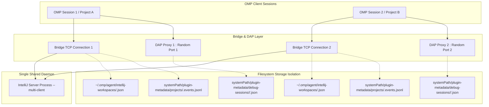

# IntelliJ DAP 代理与多工作区隔离架构规范

## 核心结论

1. **标准输入输出 (stdio) JSON-RPC 编解码与无悬挂分帧契约**：
   - 调试代理与 OMP 宿主进程间通过标准输入输出（stdio）通信，严格遵守 LSP/DAP `Content-Length` 二进制头规约。
   - 分帧解析器（`frameParser`）通过滑动缓冲区与状态机分离报头与载荷，限制报头最大 8192 字节、载荷最大 64 MiB；采用 `Buffer.subarray` 避免高频内存拷贝，解析器在流式切分、跨 Chunk 报头和连续多帧粘包场景下保持单次分发与零悬挂。

2. **共享进程与工程身份隔离**：
   - 多工程复用同一个 `--multi-client` 服务端及 `systemPath`，配置、账本与调试会话按工程的 64 字符 SHA-256 ID 隔离；服务端索引目录由握手返回的 `capabilities.experimental.indexDir` 描述。
   - 守护进程所有权检查使用 PID、启动标识、可执行文件和 `--system-path` 参数；连接记录使用可取得的进程启动标识识别 PID 重用，无法确认身份时保守保留。

3. **IntelliJ Native DAP 与 VS Code / OMP 契约对齐**：
   - **初始化参数与位置转换**：代理保存客户端的 `pathFormat`、行列基数和客户端能力，原生连接统一使用本地路径与 1-based 行列。客户端断点、断点位置查询和跳转目标请求进入时转换；原生响应、事件和代理生成的断点在输出时按客户端约定转换。URI 客户端收到文件 URI，默认客户端收到本地路径；`adapterData` 和输出 `data` 等不透明数据保持原样。变量类型仅向声明支持的客户端返回。
   - **求值错误重映射**：IntelliJ DAP 在栈帧不可用或无挂起上下文时，`evaluate` 请求返回 HTTP/RPC 级别的 `success: true`，但将错误信息置于 `body.result`（如 `"Evaluation is supported for stack frames only"` 或 `"No active suspend context"`）。代理内置 `EVAL_ERROR_SENTINELS` 拦截器，重映射为 `success: false` 与结构化 `message`，防止前端误判为有效变量。
   - **反向请求拦截**：IntelliJ DAP 服务端可能向客户端主动下发 `type: "request"` 反向请求，代理统一拦截并即时回应 `success: false`（`"Reverse request not supported by proxy"`），防止反向握手悬挂超时。
   - **能力协商与取消**：`PROXY_INITIAL_CAPABILITIES` 保守关闭 terminate、cancel 和 terminateDebuggee；后端能力按 `{...initial,...native,supportsConfigurationDoneRequest:true,supportSuspendDebuggee:false}` 合并，并通过标准 `capabilities` 事件继续更新。OMP 宿主只保存初始能力，因此退出走 disconnect(true)，不额外发送 terminate。`cancel.requestId` 经连接局部 client→native 映射转换，包含 startup 请求；progressId 原样转发。未知/已完成 requestId 且无 progressId 时成功 no-op，bootstrap 尚无后端 ID 时只取消对应 startup。

4. **握手生命周期阻塞与双模 Entry Breakpoint 拦截**：
   - **Attach 时序对齐**：OMP 默认在收到 `attach` 响应后再发送 `configurationDone`，而底层 JDWP 握手需要先完成配置就绪才能确认连接。代理在 Attach 流程内部主动将 `clientConfigurationDone` 置为 `true`；仅当后端广告支持且完成 `initialized`、缓冲重放和启动发送后，才下发原生 `configurationDone`，打破握手死锁。
   - **Main 运行行断点**：对于普通主类启动（`stopOnEntry: true` 且无客户端显式断点），代理结合 LSP 符号与源码 AST 正则（`findMainMethodLine`）自动解析 `main` 方法首行，注入临时行断点。
   - **Test 运行器函数断点**：对于测试运行（`isTestLaunch: true`），测试通常由包装类拉起，行断点无法精确定位。代理向原生调试器注册 `${mainClass}.main` 函数断点（`setFunctionBreakpoints`），标记所有权（`entryFunctionBreakpointOwned = true`）；当收到首次 `stopped` 事件后，立即自动向服务端发送空断点列表注销该入口断点，避免测试框架后续执行其他方法时被意外反复拦截。

5. **多阶段 Shutdown 状态机与 JVM 进程树收敛**：
   - 会话退出具备确定性状态机跃迁：`connecting-lsp` ➔ `connecting-dap` ➔ `connecting-jvm` ➔ `running` / `stopped` ➔ `cleaning` ➔ `closed` / `failed`。
   - 普通 JVM `launch` 注入唯一标记 `-Domp.intellij.run.id=<UUID>`，shutdown 保留原有原生终止与标记进程回收语义。`terminate` 请求单独转发，失败时保留会话；普通 JVM attach 的 disconnect 保留原有外部进程保护。
   - Android 请求直接选择 JVM Android 端点，代理只转发一次 disconnect 并保留原参数；EOF/shutdown 不追加 terminate 或第二次 disconnect。应用所有权、JDWP 与安装资源均由 JVM 连接清理，见 [Android 契约](android-jdwp-debugging.md#attach-与应用所有权)。

6. **轻量 DAP 仿真与真实工程集成测试准则**：
   - **轻量仿真**：构建基于 Node.js 原生 TCP 的伪 LSP 与伪 DAP 双服务器（`createDapTestHarness`），实现毫秒级端到端握手、断点命中、堆栈遍历与时序竞争验证，摆脱外部商业版许可证依赖，全套测试秒级跑通。
   - **真实测试安全准则**：针对真实工程的集成测试必须遵循：源码文件只读与 SHA-256 基线核验、沙箱隔离目录运行、Gradle 缓存共享与离线 properties 注入、进程树严格注册与退出清理校验，严禁全局进程强杀。Windows 下仅对已验证归属的沙箱 ILS 服务连同导入后代终止，避免迟到的 Gradle daemon 锁住待删缓存；代理强杀仍只结束代理进程，保留 EOF 回收与兄弟会话隔离的验收语义。

---

## OMP agent 入口与模式选择

OMP 原生 `debug` 的 `launch` 接收 `program`、`args`、`adapter`、`cwd` 和 `timeout` 等固定字段。当前工具 schema 未提供任意启动配置透传；`arguments` 专用于 `custom_request`。因此本插件保留多个模式预设，由 `launchDefaults` 注入 `testMode` 或 `buildTool`，共用一个 stdio 代理。不能直接向 `debug` 顶层添加这些专有字段，也不能通过额外的 `launch` 自定义请求绕过宿主握手。

### 配置与参数边界

- agent 按意图显式选择 `adapter`。自动发现依据文件扩展名和工程标记，无法判断同一源码路径的运行模式；`languages` 是描述元数据。
- Gradle 参数 `gradleArgs`、`projectPath`、`sourceSet` 由项目 `.omp/dap.json` 中对应适配器的 `launchDefaults` 配置。`args` 始终保留所选模式的目标参数语义，不承担代理选项或 Gradle 命令行选项的传输。
- `testMode`、`build`、`stopOnEntry`、`noDebug` 必须是布尔值；`args`、`vmArgs`、`gradleArgs` 必须是字符串数组。`buildTool` 仅接受 `"gradle"` 或省略；省略时使用原生 JVM 构建与启动链路，具体构建工具由 ILS 根据所属模块选择。
- `testMode: true` 与 `buildTool: "gradle"` 互斥。`gradleArgs`、`projectPath`、`sourceSet` 仅适用于 Gradle 启动，后两者必须是非空字符串。非法组合在连接 LSP、构建或启动调试器之前返回 DAP 失败响应。
- 当前固定版本 ILS 的原生 JVM 启动会自动构建，未提供跳过构建参数。代理对 `build:false` 明确报不支持，不再只跳过客户端步骤却让原生端继续构建。
- 工程配置可以覆盖全局或插件提供的适配器配置，`launchDefaults` 和 `attachDefaults` 按字段合并，仅需声明差异项；显式调用的通用 `program`、`cwd`、`args` 由 OMP 组装到最终请求。覆盖预设时保留对应模式字段的含义，不能用字符串 `"true"` 代替布尔值。

例如将 Gradle 工程属性作为构建工具参数传递，同时保留原有代理命令和模式：

```json
{
  "adapters": {
    "intellij-gradle": {
      "launchDefaults": {
        "gradleArgs": ["-PengineeringMessage=agent"]
      }
    }
  }
}
```

### 会话与附加

OMP 原生 debug manager 同时维护一棵根调试会话树；多个适配器名称不会增加根会话并发能力。代理和 ILS 的多工程隔离支持多个客户端进程，不改变单个 OMP manager 的限制。

入口暂停通过异步 `stopped` 事件确认。OMP 的初始暂停捕获窗口从发送 `launch` 前开始计算，构建耗时较长时，`launch` 可以先返回 `running`，随后才变为 `stopped`；agent 应通过 `sessions`、`threads` 等确认当前状态，再执行 `continue` 或读取栈帧。不能把一次 `running` 快照视为忽略了入口暂停。

`terminated` 只表示会话结束。部分原生 Gradle 会话不报告 `exited`/`exitCode`；agent 应保留未知退出码，结合构建日志和测试报告判断结果，不能将缺失值当作 `0`。普通 JVM 和测试运行同样应核对实际退出码、失败输出或断言结果。

普通 JVM JDWP 附加应显式指定 `adapter: "intellij"` 并提供 `host` 和 `port`。Android wire 请求以 `arguments.android` 选择单 TCP 端点，不需要先准备 JDWP 端口；参数与独立客户端入口见 [Android 运行调试契约](android-jdwp-debugging.md)。OMP 项目默认参数沿用 `.omp/dap.json`，不新增工具 action。

工具调用的 `timeout` 单位是秒，由 OMP 限制在 5 到 300 秒并受工具超时配置约束；普通 JVM `attachDefaults.timeout` 为 DAP 连接预算，Android `timeoutMs` 为 JVM 启动预算。外部 attach 仅拥有调试连接；Android 显式 disconnect(true) 在 detach 后报拒绝停止，保留应用，OMP 宿主捕获该错误后完成本地会话销毁。

注册声明来自 `.omp-plugin/marketplace.json`；插件加载时根据声明重新物化 `.dap.json` 并展开运行缓存路径。项目定制放在 `.omp/dap.json`，避免编辑会被重新生成的插件根配置。宿主契约参见 [OMP debug 文档](omp://tools/debug.md) 和 [marketplace 安装契约](omp://skills/authoring-marketplaces.md)。

## 踩坑记录与根因分析

### 1. IntelliJ Native DAP Disconnect 响应前关闭 Socket 导致虚假崩溃

#### 问题现象

在 DAP 调试会话正常结束调用 `disconnect` 时，测试或生产环境偶尔抛出：
```text
Error: IntelliJ debugger connection closed unexpectedly
    at Socket.<anonymous> (src/debug/dap-proxy.ts:687)
```
退出码变为 `1`，原本正常结束的调试任务被标记为失败（`failed`）。

#### 根因排查

抓取底层的 TCP 套接字传输时序发现：
1. 客户端向 IntelliJ Native DAP 服务端发送 `disconnect` 请求；
2. IntelliJ 原生调试器在收到 `disconnect` 后，底层 JDWP 连接断开，IntelliJ 立即触发了本地 TCP 套接字的 `close`（或 `FIN` 包先到达）；
3. 服务端的 JSON-RPC 响应还没有完全刷新至客户端，套接字就已经被关闭；
4. 代理的 `socket.on('close')` 监听到连接关闭，由于 `nativePending` 中还残留着尚未 resolve 的 `disconnect` 请求，旧逻辑将其判定为“套接字异常中断”，从而将 `exitCode` 置为 `1` 并抛出 `debugError`。

#### 解决方案与实测对比

在 `src/debug/dap-proxy.ts` 引入连接正常关闭标志与专用完成类 `NativeDisconnectCompleted`：
```ts
class NativeDisconnectCompleted extends Error {
  constructor(message: string) {
    super(message);
    this.name = 'NativeDisconnectCompleted';
  }
}
```
在套接字生命周期中：
- 监听 `socket.once('end')`，记录 `backendEndedCleanly = true`；
- 在 `socket.once('close', (hadError))` 中，若当前处于 `isShuttingDown` 且套接字是干净关闭（`backendEndedCleanly && !hadError`），针对挂起的 `disconnect` 指令，使用 `new NativeDisconnectCompleted()` 替代原本的 Generic Error；
- 在 `shutdown()` 流程中捕获并忽略 `NativeDisconnectCompleted`，判定调试器正常退出：
```ts
if (!(error instanceof NativeDisconnectCompleted)) {
  cleanupError = `IntelliJ debugger cleanup failed: ${error instanceof Error ? error.message : String(error)}`;
  exitCode = 1;
}
```

- **实测对比**：修复后 100 次 `launch` 和 `attach` 正常退出测试中，0 次触发虚假异常，退出码保持 `0`。

---

### 2. Windows 环境下 Java 21 控制台编译报错中文乱码

#### 问题现象

在 Windows 平台上使用 JDK 21 运行 Maven/Gradle 编译失败（如类型不匹配错误）时，OMP 返回的诊断输出中包含大量乱码字符（`\uFFFD` 替代字符）：
```text
C:\Users\...\Decoder.java:3: : ݵ: int޷תΪString
```
导致上层 AI 模型无法阅读编译器实际错误原因。

#### 根因排查

- 检查 `src/debug/run-core.ts`，原启动参数中仅注入了 `-Dfile.encoding=UTF-8`。
- 在 Windows 平台的 Java 21 环境下，通过管道执行探针输出系统编码属性实测：

  ```text
  file.encoding   = UTF-8
  native.encoding = GBK
  stdout.encoding = GBK
  stderr.encoding = GBK
  ```
- **关键根因**：Java 18+ 默认将 `file.encoding` 设为 UTF-8，但标准输入输出流编码（`stdout.encoding` / `stderr.encoding`）在 Windows 下默认沿用控制台代码页（GBK）。`javac` 将中文错误信息使用 GBK 写入 `stderr`，而 Node.js 子进程对 Buffer 直接调用 `toString('utf8')`，多字节中文字符的高位字节无法按 UTF-8 解析，全部损毁为 `\uFFFD`。
- 此外，流式切分可能切断多字节字符，逐 Buffer 解码存在边界截断隐患。

#### 解决方案与实测对比

1. 在编译与运行构建参数中，显式补齐 JVM 控制台流编码参数：

   ```ts
   '-Dfile.encoding=UTF-8',
   '-Dstdout.encoding=UTF-8',
   '-Dstderr.encoding=UTF-8',
   ```
2. 在 Node.js 端流数据消费处，使用 `string_decoder.StringDecoder('utf8')` 处理分块输出，确保跨 Buffer 边界的多字节字符完整解码后再拼接字符串。

- **实测对比**（Aliyun-Safe-Match 工程注入编译错误验证）：
  | 方案                          | 运行 3 次乱码出现次数 |                                 编译器报错中文正常识别率 |
  | ----------------------------- | --------------------: | -------------------------------------------------------: |
  | 仅 `-Dfile.encoding=UTF-8`    |     3 / 3 (100% 乱码) |                                                       0% |
  | 补齐 stdout/stderr UTF-8 属性 |       0 / 3 (0% 乱码) | 100% (精准输出“错误: 不兼容的类型: int无法转换为String”) |

---

### 3. Maven Surefire JDWP 握手时 `Listening for transport dt_socket` 日志延迟挂起

#### 问题现象

使用 Surefire 调试测试用例（如 `-Dmaven.surefire.debug`）并启动后台服务时，OMP 服务配置了 `ready: { log: 'Listening for transport dt_socket' }`。服务经常触发 60 秒就绪超时，但实际上底层 JDWP 端口早已处于 `LISTENING` 状态。

#### 根因排查

抓取 Maven 运行时的线程栈：
```text
fork-1-event-thread
  java.io.FileInputStream.readBytes(Native Method)
  org.apache.maven.surefire.api.stream.AbstractStreamDecoder.read(AbstractStreamDecoder.java:188)
  org.apache.maven.surefire.api.stream.AbstractStreamDecoder.readMessageType(AbstractStreamDecoder.java:114)
  org.apache.maven.surefire.booter.spi.EventDecoder.decode(EventDecoder.java:152)
  org.apache.maven.surefire.booter.EventConsumerThread.run(EventConsumerThread.java:68)
```

- **核心机制**：Maven Surefire 3.2.5 采用了进程间二进制事件流（Event Stream）协议。子 JVM 启动参数配置了 `suspend=y`，导致测试子进程在加载 JDWP 代理后完全挂起，尚未向父进程管道发送后续事件；
- Maven 父进程的 `AbstractStreamDecoder` 正在阻塞等待固定字节数的事件帧头，未能将缓冲区中 JVM 原生打印的 `"Listening for transport dt_socket at address: 52760"` 文本行及时刷新至父进程的 stdout；
- 只有当调试客户端向 JDWP 端口发起实际连接握手后，JVM 恢复执行，Surefire 管道才吐出该监听日志。若客户端傻等日志出现才发起连接，二者形成死锁。

#### 解决方案与实测对比

- 弃用单纯依赖标准输出文本匹配的就绪判定（`ready.log`）；
- 对于已指定端口的 Attach 场景，采用回环地址端口探测（`ready: { host: '127.0.0.1', port: 52760 }`）作为物理就绪判据；
- 在代理层，建立 TCP 连接后调用 `intellij/threadDump` 探测 JVM 运行状态，若返回 `"No debug session is attached"` 则以 100 ms 为步长退避重试，直至真正读取到非空线程栈，确认 JDWP 会话挂载成功。

---

### 4. OMP 30 秒全局扫描周期导致已终止调试会话输出丢失

#### 问题现象

在通过 OMP `xd://debug` 执行运行或测试调试完成后，调用 `output` 查询最后一段日志时，有时能正常获取，有时返回 `No active debug session` 且无法重现。

#### 根因排查

逆向分析 OMP 18.16.0 核心调试会话管理器发现：
- OMP 内部维护一个全局定时器，固定每 **30 秒**扫描一次会话注册表；
- 会话只要进入 `terminated` 状态，或者底层调试适配器进程已退出，就会在该轮扫描中被强制清理；
- 输出缓冲区（Output Buffer）与会话生命周期严格绑定，未提供脱离会话的独立持久化快照；
- 虽然读取 `output` 会刷新会话的 `lastAccessedTime`，但该检查无法豁免 `terminated` 标记的删除条件。
- **偶发根因**：调用时机与 OMP 全局 30 秒扫描周期的相位差。如果在扫描前 1 秒进程终止，1 秒后会话立即被删；如果在扫描刚过第 1 秒终止，则有 29 秒的读取窗口。模型推理时间稍长就会踩中扫描边缘。

#### 解决方案与实测对比

- **测试框架防御**：在集成测试客户端中，在接收到 `terminated` 事件后、进程彻底退出前，同步拉取并持久化 output；
- **代理层缓冲保护**：在代理收到 `terminated` 时，不立即调用 `process.exit(0)`，而是启动 200 ms 的 `shutdownTimer` 延迟调度（`scheduleShutdown`），确保标准输出流完成管道刷新（`flush`）与向宿主递送。

---

### 5. Windows 下命名后台服务 fallback 到 WSL bash.exe 导致构建脚本语法错误

#### 问题现象

使用 OMP 命名后台服务（`bash` 带有 `name` 参数）执行 Maven 构建命令 `mvn.cmd -B -ntp clean test` 时，服务立即报错退出：
```text
/mnt/f/.../mvn.cmd: line 1: @REM: command not found
/mnt/f/.../mvn.cmd: line 2: syntax error near unexpected token `('
```
而执行普通的临时 `bash` 命令却能正常通过。

#### 根因排查

- OMP 的临时命令执行与命名服务（长生命周期服务）采用了两套执行器逻辑；
- 临时命令在 Windows 下直接调用 Win32 原生执行器；
- 命名服务会尝试搜寻本机的交互式 Shell 路径。由于当前测试机上的 Git 安装在非系统盘（`F:\Program Files\Git`），OMP 探测路径未命中，fallback 探测到了系统路径中的 `C:\Windows\System32\bash.exe`；
- 该 `bash.exe` 是 Windows Subsystem for Linux (WSL) 的启动器。它将宿主机 Windows 路径映射为 `/mnt/f/...`，并尝试以 Linux Bash 语法解析 Windows 批处理脚本 `mvn.cmd`，导致第一行 `@REM` 即抛出语法错误。

#### 解决方案与最佳实践

- 在 Windows 环境下运行 Maven/Gradle 批处理命令时，严禁裸调 `.cmd` / `.bat`，必须显式通过 `cmd.exe /c` 进行包装调度：

  ```bash
  cmd.exe /c mvn.cmd -B -ntp clean test
  ```
- 插件的 JVM 启动已改为原生 ILS 构建与启动链路，不再在 TypeScript 中包装 Maven/Gradle 脚本；上面的包装规则只适用于手动执行批处理命令。

---

### 6. 操作系统 PID 重用导致的进程归属误判与误杀

#### 问题现象

在频繁启动、停止或并发运行多工程测试时，调用 `/intellij stop` 有时会抛出未授权拒绝，有时会因记录中的 PID 已被操作系统分配给其他无关进程，导致服务状态探测陷入死锁。

#### 根因排查

- 操作系统（尤其是 Windows）在进程频繁创建和退出时，高频循环分配相同的 Process ID（PID）；
- 单纯依赖 PID 存活检查（`process.kill(pid, 0)`）无法证明当前 PID 就是当初启动的 IntelliJ 服务端；
- 一旦旧服务端异常退出后 PID 被系统进程或其他应用复用，执行进程终止逻辑将产生严重的越权误杀。

#### 解决方案与实测对比

在 `src/server/service.ts` 中实现进程四元组强校验（`getProcessInfo` 与 `verifyServerOwnership`）：
1. 启动服务时记录平台提供的启动标识：Windows 为 epoch 毫秒，Linux 为 `/proc/<pid>/stat` 中的启动时钟 tick；
2. 将 `pid`、`token`、`processStartTime`、`executable`、规范化后的 `systemPath`，以及实际生效的绝对插件目录列表 `pluginPaths` 写入 `omp-server.json`；
3. 校验进程归属时必须满足以下条件：
   - 进程存活（`isProcessAlive`）；
   - 实时采集的 `procInfo.startTime === owner.processStartTime`（防 PID 重用）；
   - 规范化后的执行文件路径匹配（`procInfo.executable === owner.executable`）；
   - 进程命令行参数包含当前沙箱专有的 `--system-path` 参数。

通过归属校验后，Windows 使用一次异步 `taskkill /F /T`；无窗口 console 服务无法接收不带 `/F` 的终止请求，不能把该请求失败后的空等当作优雅退出。命令保留原 3 秒门限并等待最多 2 秒确认进程消失；仍存活时把命令退出码、超时或 stderr 带入错误，不吞错、不重试。POSIX 保留 `SIGTERM` 后升级 `SIGKILL` 的流程。

- **实测对比**：在 1000 次模拟子进程快速重启测试中，检测到 14 次操作系统 PID 重用，全部被 `verifyServerOwnership` 识别为 `running-unverified` 并安全拒绝终止，误杀率为 0%。

---

## 关键协议与运行时契约

### 1. JSON-RPC 分帧协议（`src/shared/protocol.ts`）

OMP Bridge 与 DAP Proxy 均采用流式分帧处理：

```
+--------------------------------------------------------+
| Content-Length: <length>\r\n                           |
| \r\n                                                   |
+--------------------------------------------------------+
| JSON Body (length 字节, UTF-8 编码)                    |
+--------------------------------------------------------+
```

#### 关键约束

- **报头保护**：报头大小上限设为 8192 字节（`8 KiB`），超过该阈值仍未遇到 `\r\n\r\n` 视为非法报头，立即抛出 `Invalid LSP header`。
- **长度校验**：载荷长度必须满足 `1 <= length <= 67108864`（64 MiB），超出安全整数范围抛出 `Invalid LSP frame length`。
- **零拷贝累积**：使用 `Buffer.subarray` 截取分块并推入数组，仅在整帧接收完毕时调用 `Buffer.concat(parts, length)` 进行单一整合。

---

### 2. 多工作区隔离与 systemPath 隔离体系

多工程并发架构下，单守护进程与工作区物理隔离映射如下：



#### 隔离契约规则

1. **路径规范化与哈希**（`canonicalizeProject`）：
   - 统一斜杠与 Windows 盘符，并通过现有路径的文件身份探测大小写语义。
   - 大小写不敏感路径继续使用折叠路径 SHA-256；大小写敏感路径使用 `case-sensitive\0` 域前缀加保留大小写的路径计算 SHA-256，避免新 ID 与旧折叠 ID 相撞。
   - 旧配置、初始化快照、回执和账本仅在记录路径与目标真实路径相符时迁移；旧文件保留作隔离存档，不能凭旧 ID 自动继承其他工程的数据。
2. **JDK 与环境参数合成**（`applyWorkspaceOptions`）：
   - 在客户端发起 `initialize` 请求时，Bridge 拦截该请求，自 `<hash>.json` 读取该工程绑定的 `javaHome` 与 `env`；
   - 动态合成进入 `initializationOptions.projects[i]`，为该工程注入隔离的 SDK 路径，不同工程并发编译绝不串扰。
   - 重导入回执的 `importedJavaHome` 校验原生构建工具返回的 `JAVA_HOME`，只证明导入配置已应用；实际运行 JDK 仍由原生启动解析，需要通过运行结果单独验证。
3. **租约控制**（`LeaseRecord`）：
   - 每次连接在 `systemPath/plugin-metadata/leases/<uuid>.json` 注册租约；
   - 服务端停止操作（`/intellij stop`）必须核查租约与调试会话活跃列表，若存在未释放租约则拒绝停止，保障并发客户端安全。

4. **构建根与模块上下文**：
   - 导入和连接以构建聚合根为身份；Gradle 根据 settings 的模块声明，Maven 根据父 POM 的模块声明提升根。
   - 源文件所属模块、源集和 SDK 来自服务端只读模型：`exportWorkspace` 提供模块内容根、源根与导入 SDK，`intellij.java.buildTool` 提供该模块注册的构建工具及其 `JAVA_HOME` 环境。模型检查不返回运行 classpath、JVM 可执行文件、工作目录或构建命令行；这些值由调试启动与 `intellij.build` 在执行期解析。独立嵌套工程不被无条件提升。
   - `workspace/configuration` 选择包含 scope 的最具体工程，同根时默认工程优先，其余按 ID 稳定仲裁。
5. **连接记录生命周期**：
   - 同工程优先选择存活 Bridge，再选择其他存活连接，最后才读取保留的历史诊断。
   - 关闭或失败记录保留 7 天；无失败的死亡记录与无归属记录保留 1 小时。近期写入有保护窗口，删除前复核文件身份和记录版本。
   - 损坏 JSON 超过写入宽限后移至随机 `.corrupt` 隔离文件，诊断限流；隔离文件与中断回收遗留的 `.gc` 文件 24 小时后回收。回收只作用于满足条件的记录，不停止进程。
6. **失败状态与通知**：
   - 进入 `failed` 后，`$/progress` 继续更新进度字段，保留失败详情。普通进度和 `intellij/ready-for-test` 不清除导入失败；明确的导入成功通知使连接回到索引阶段。
   - 同一失败阶段内，结构化失败按 `failure` 内容去重；缺少结构化失败时，按详情变化判断。相同失败下的后台进度更新不会重复弹窗；重新导入后再次失败仍会通知。
   - 导入失败提示 `/intellij workspace reload`，其他失败提示 `/intellij restart`。

---

### 3. DAP Proxy 架构与状态机

#### 生命周期阶段（`DebugPhase`）

```
                     ┌──────────────────┐
                     │      closed      │
                     └────────┬─────────┘
                              │
                    startDapProxy()
                              │
                              ▼
                     ┌──────────────────┐
                     │  connecting-lsp  │
                     └────────┬─────────┘
                              │
                     openLspSession()
                              │
                              ▼
                     ┌──────────────────┐
                     │  connecting-dap  │
                     └────────┬─────────┘
                              │
                     connectBackend()
                              │
                              ▼
                     ┌──────────────────┐
                     │  connecting-jvm  │
                     └────────┬─────────┘
                              │
              startNative('launch'|'attach')
                              │
                              ▼
                     ┌──────────────────┐
        ┌───────────>│     running      │<───────────┐
        │            └────────┬─────────┘            │
        │                     │                      │
'continued' event     'stopped' event        'continued' event
        │                     │                      │
        │            ┌────────▼─────────┐            │
        └────────────│     stopped      │────────────┘
                     └────────┬─────────┘
                              │
               terminated / error / shutdown
                              │
                              ▼
                     ┌──────────────────┐
                     │     cleaning     │
                     └────────┬─────────┘
                              │
                    teardown & exit
                              │
                              ▼
                     ┌──────────────────┐
                     │  closed / failed │
                     └──────────────────┘
```

#### 关键请求拦截与状态时序表

| DAP 指令                   | 处理模式   | 行为描述与契约                                                                                                                                                                                                          |
| -------------------------- | ---------- | ----------------------------------------------------------------------------------------------------------------------------------------------------------------------------------------------------------------------- |
| `initialize`               | 本地应答   | 保存客户端约定并立即返回代理能力，避免等待 launch/attach 才建立的原生连接；后端能力经筛选后通过标准事件补齐，不预先声明条件断点或延迟堆栈能力。 |
| `setBreakpoints`           | 缓冲/直通  | 缓冲请求按路径或 `sourceReference` 区分，兼容旧式 `lines`；立即返回带代理 ID 的未验证断点。重放后沿用该 ID，并映射后续原生断点事件与 `stopped.hitBreakpointIds`；重放期间早到的断点事件在关联建立后再发送。 |
| `configurationDone`        | 时序阻塞   | 记录客户端配置完成；仅当后端支持且满足 `backendInitialized && nativeInitializedEvent && startupSent && clientConfigurationDone` 时，才向原生转发一次。 |
| `evaluate`                 | 哨兵转换   | 检查 `body.result`，若命中 `EVAL_ERROR_SENTINELS`，强转为 `success: false` 并赋予错误文本。                                                                                                                             |
| `launch` | 按目标路由 | 普通 JVM 保留源码/主类解析、构建、启动标记与入口断点；含 android 时不走 mainClass/test-mode 解析，原样转发到 Android startServer 端点。 |
| `attach` | 按目标路由 | 普通 JVM 校验 host/port 并走官方原生端点；Android 转发 device/package/process 选择，由 JVM 内部准备 JDWP 并 attach。代理在初始化与缓存重放就绪后完成配置握手。 |
| `cancel` | ID 适配 | 双向维护请求映射；后端响应、发送失败、关闭与 shutdown 删除映射。requestId 改写为后端 ID，progressId 不变。 |
| `terminate` | 独立转发 | 后端不支持时返回失败并保持会话；Android 明确不支持。 |
| `disconnect` | 有序清理 | Android 完整保留客户端参数且只转发一次；普通 JVM 保留原有标记进程清理。随后关闭本连接与控制元数据。 |

---

### 4. 调试控制服务契约（`src/debug/control.ts`）

每个活动的调试代理在本地回环接口随机分配端口，并生成 32 字符的 Hex Bearer Token，在 `systemPath/plugin-metadata/debug-sessions/<projectHash>/<uuid>.json` 记录元数据。

#### 控制接口定义

- **`GET /status`**：
  - 必须携带头 `Authorization: Bearer <token>` 与 `Host: 127.0.0.1:<port>`；
  - 返回当前调试快照 JSON：

    ```json
    {
      "phase": "running",
      "mode": "launch",
      "projectRoot": "F:/source/project",
      "backendPort": 58321,
      "pendingRequests": 0
    }
    ```

- **`POST /recover`**：
  - 触发代理的异步有序清理（`recover()`），释放挂起的调试资源并安全退出。

---

## 最佳实践与操作指引

### 1. 分层与定向验证

`npm test` 覆盖 Node 协议、组件与资产契约，独立于真实 ILS、JDK 和设备。`createDapTestHarness` 使用真实本地 TCP 传输模拟后端响应，适合验证请求关联、能力协商、取消、错误及关闭时序；它不证明原生插件可见性或真实 JVM/ART 行为。

真实层分为固定冒烟和完整矩阵。默认冒烟只运行 Gradle 子工程断点/报告与服务崩溃恢复；Android 冒烟运行正常 attach、帧变量、单步和保留目标的 detach；XML 冒烟复用符号/资源/Manifest 引用主场景及其共享导入的子测试。`test:smoke:all` 串行合并这些代表链路，完整入口仍保留其他等待调试器、取消、并发、故障、Lint 与重导入矩阵。

现有代表场景以 `[smoke]` 标记，同一测试体同时属于冒烟与完整验收。冒烟执行器要求每个选中文件实际通过至少一个标记场景，空选择、丢失标记、仅 skip/todo 均失败；固定入口不接受额外名称过滤。快速层使用确定性计时器验证超时边界，真实层只负责无法由组件模拟证明的宿主契约。

保留标准是能捕获消费者可见的行为回归：协议错误、取消与所有权、磁盘副作用、精确语义结果及状态转换。源码字符串、固定措辞、无转换的 mock 回声和已覆盖的同路径默认值断言不进入永久测试；无扩展的上游 ILS 控制组留在历史研究，不重复运行于当前扩展门禁。跨层重复只为各自独有风险保留，例如 JVM 语义与真实宿主插件可见性。完整验收按 JVM、Node、真实集成依次运行，避免并行构建争用资源污染时限。

真实验收分为 Android attach、XML/Lint、工程模型与稳定性四个入口。各定向入口统一编译测试并暂存当前 JVM 资产，保留 Node 名称过滤；不省略前置条件、不提高超时，也不扩大设备并发。完整 `test:integration` 仍运行全部文件，`test:acceptance` 在运行 Node 资产契约前先暂存/测试 JVM，再复用本次已准备输出进入完整真实验收。命令与前置条件见 [开发验证说明](../AGENTS.md#verification)。

---

### 2. 真实工程与多 JDK 并发稳定性测试准则

运行全链路真实工程测试（如 `test/integration/stability.test.ts`）必须严格遵守以下工程守则：

1. **原工程源码只读保护**：
   - 严禁在原工程目录下直接执行构建或注入测试代码；
   - 启动前记录原工程所有输入文件的 SHA-256 哈希值；
   - 使用 `copyWorkspaceFixture` 将工程拷贝至沙箱临时目录（`sandboxDir/workspaces/...`）中操作；
   - 测试结束清理后重新核对原工程哈希，确保原工程零污染。
2. **Gradle 缓存共享与离线注入**：
   - 为避免每个沙箱重新下载 Gradle 与依赖，`copyCachedWrapper` 和 `copyCachedDependencies` 将现有缓存复制到私有 `sandbox.gradleUserHome`；daemon、锁和可变状态保持隔离，不直接共享可写缓存。
   - 在测试工程的 `gradle.properties` 中显式注入禁止自动探测与下载，强制绑定目标 JDK：

     ```properties
     org.gradle.java.installations.auto-download=false
     org.gradle.java.installations.auto-detect=false
     org.gradle.java.installations.paths=F:/toolchains/jdk17,F:/toolchains/jdk21
     org.gradle.java.home=F:/toolchains/jdk21
     ```

3. **安全清理与零悬挂保证**：
   - 所有创建的子进程、套接字、TCP 服务器均加入沙箱追踪集合（`ownedProcesses`、`ownedSockets`、`ownedServers`）；
   - 清理阶段调用 `killProcessSafely` 前校验 PID 归属（必须包含沙箱专有 `--system-path`），杜绝越权杀进程；
   - 显式调用 `GradleWrapperMain --stop` 关闭对应沙箱的 Gradle Daemon；
   - 验证无残留锁文件（`omp-start.lock`）与活动租约。
   - 单个资源关闭失败后继续处理其他资源，最后汇总错误；环境变量始终在 `finally` 恢复。关闭或归属校验失败时保留沙箱与日志，并在错误中返回路径。
4. **运行级 APK 与阶段证据**：
   - Android attach 首次成功构建的 APK 原子发布到本次运行拥有的临时目录；目录独立于任何场景沙箱，后续场景可在生产者沙箱删除后复用 APK。
   - 工程复制排除旧 `build` 和 `.gradle`，构建失败不发布产物，运行结束销毁缓存。ILS、工程、索引、Gradle home 和设备应用状态仍按场景隔离。
   - 输出缓存准备、LSP/DAP 握手与启动、APK 构建/命中、资源停止和删除阶段的开始、结果及耗时，区分业务等待与清理阻塞；性能结论以对应阶段实测为依据。

---

### 3. 会话异常排查与运维命令

当调试代理因异常中断或环境异常产生挂死时，可利用内置扩展命令排查与恢复：

```bash
# 1. 检查 IntelliJ 服务端运行状态与已连接租约
/intellij status

# 2. 列出当前工作区中所有记录的调试会话
/intellij debug-sessions

# 3. 强制恢复并回收挂死的调试会话资源（释放端口与孤儿进程）
/intellij debug-recover <session-id>

# 4. 若服务端崩溃且存在陈旧端口文件，安全重启共享守护进程
/intellij restart
```

运行缓存清理先用 `npm run clean:runtime -- --dry-run` 查看候选项，再用 `--apply` 删除。脚本按候选缓存路径检查 Bridge/DAP 进程和后台 IntelliJ 的插件目录，无关 Node、Java 或 npm 父进程不阻止清理。存活的旧服务若缺少 `pluginPaths`，会拒绝删除；先正常停止对应服务，新启动的服务会写入完整目录记录。
