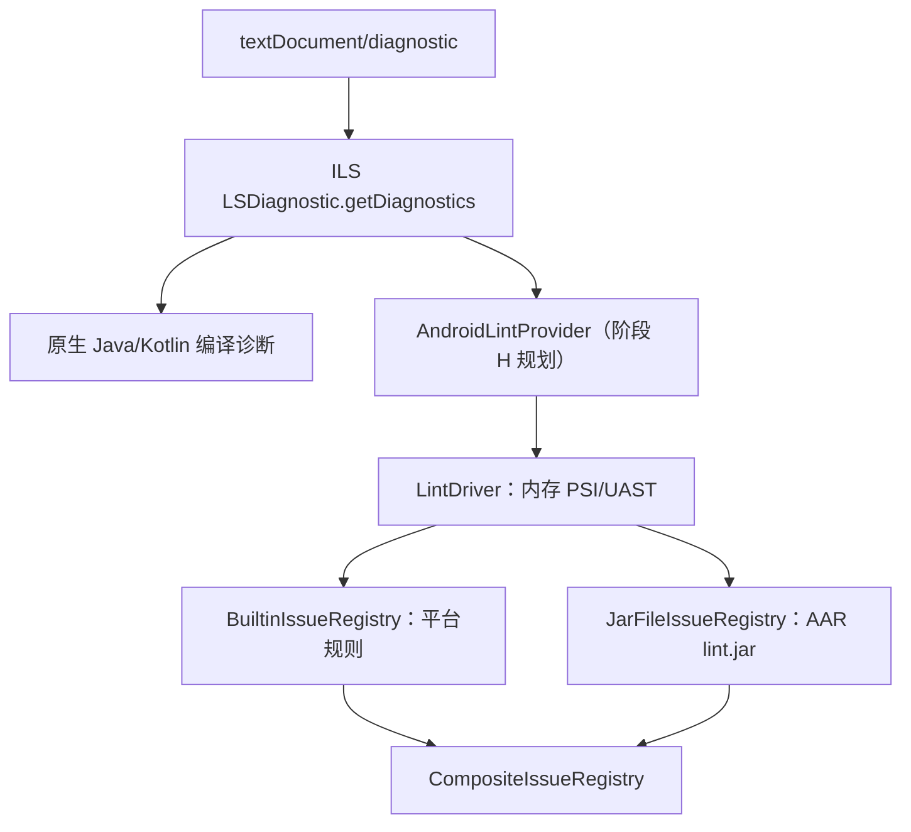

# IntelliJ Language Server (ILS) 私有协议与生命周期治理规范

## 核心结论

1. **版本演进与锁定契约（263.7084.0 -> 271.2085.0 JBR 25）**：
   - 上游 ILS 升级至 `271.2085.0`，底层运行环境变更为 JBR 25（`25.0.4.1`，类字节码 major 69）。平台运行时将 `idea.plugins.compatible.build` 设为 `999.SNAPSHOT`，JVM 插件 `plugin.xml` 必须仅声明 `<idea-version since-build="271"/>`，并在 TypeScript 启动层通过 SHA-256 与 `build.txt` 实行精准强锁定。
   - 彻底废弃运行时向 GitHub / Open VSX 发起动态版本探测（`latest`），安装过程只消费内置锁定的发行版元数据；上游版本与元数据更新收敛为离线维护工具 `scripts/update-server-bundle.mjs`。

2. **`server.port` 格式变更根因与防御**：
   - ILS 263 的 `server.port` 文件仅含单行端口号，而 271 版本变更为三行结构（第 1 行：端口号，第 2 行：服务端 PID，第 3 行：构建号 `ILS-271.2085.0`）。
   - 若直接对文件内容调用 `Number()` 解析，多行文本会导致结果计算为 `NaN`，服务端已在 1.2 秒内正常监听却被误报为“30 秒启动超时”。解析逻辑必须统一收敛为提取首行、正则匹配纯数字并做 `1–65535` 范围校验的 `parsePortFile`。

3. **二进制分发与资产双通道校验**：
   - Open VSX 的完整扩展包（VSIX）体积达到约 13.5 MB，元数据解析缓冲区必须从 4 MB 提升至 32 MB，超时放宽至 120 秒，杜绝静默截断降级。
   - 插件资产管道实行文本与二进制严格分流：配置文件按 UTF-8 字符串读写并计算哈希；JAR、SO 等二进制资产使用 `Buffer` 读取、校验 SHA-256 旁挂摘要并原样写入，避免 UTF-8 编码将非法字节替换为 `0xFFFD` 造成字节码损毁。

4. **版本发布遵循 CalVer 规范与自动同步**：
   - 插件版本号采用日期规范（CalVer，如 `YYYY.M.D` 或 `YYYY.MMDD.PATCH`），消除 SemVer 在语言服务封装层中 Major/Minor/Patch 边界模糊的问题，同时严格遵守 npm 禁止版本号数字段包含前导零的规则。
   - 通过 `--sync-marketplace` 工具自动化提取上游 VSIX 中的 `activationEvents`（生成 `rootMarkers`）与配置默认项，同步维护 `.omp-plugin/marketplace.json`。

5. **Agent 优先的 QuickFix 边界**：
   - 标准重命名、文件重命名和 CodeAction 应用复用 OMP 原生 `lsp`。Bridge 仅保留工程身份、状态与索引屏障、Android 协议适配；私有交互交给宿主，不增加第二套编辑引擎、补全弹窗或系统剪贴板操作。动作列表和 RPC 成功均不能证明交互式重构全部完成。

6. **MCP 工具动态发现机制替代客户端硬编码**：
   - 服务端通过 `executeCommandProvider.commands` 暴露 `list-mcp-tools` 与 `run-mcp-tool`。通过发送 `{"command":"list-mcp-tools","arguments":[]}` 可动态拉取当前项目可用的 22 项 MCP 工具定义及其完整的 `inputSchema`。
   - 工具调用必须封装为 `{"command":"run-mcp-tool","arguments":[{"tool":"<tool_name>","arguments":{...}}]}`，严禁传错参数结构（缺少外层包装对象会触发服务端 `-32602` 参数校验异常）。能力广告不等于可用性证明，未构建或缺少模块元数据时部分工具（如 `list_directory_tree`）会返回执行错误。

7. **同进程 Android Lint**：
   - `AndroidLintProvider` 已接入标准 `textDocument/diagnostic`，与 ILS 原生 Java/Kotlin 编译诊断合并；工程依赖 AAR 的规则通过官方 `JarFileIssueRegistry` 装载。
   - 当前发布清单含 16 个 JAR，采用描述符、必选核心内容模块与可选 Run/DAP 内容模块分离的 `android.lsp` 布局，详见 [Android JVM 扩展指南](android-jvm-extension.md#6-构建资产清单与安全替换契约)。下方 6 JAR 依赖子集和耗时属于历史探针，不能替代当前完整内置规则集与发布资产的验收。
   - 阶段 H 的 Java/Kotlin 与[阶段 I 的 XML/Manifest 诊断](android-jvm-extension.md#8-xmlmanifest-lint阶段-i)均已验收。真实独立 ILS 271 完整运行包含无扩展原生对照、实际 AGP 合并来源及缓存切换；既有 Java/Kotlin/Compose 和导航回归通过。

---

## 踩坑记录与根因分析

### 1. `server.port` 三行格式解析异常导致虚假启动超时

#### 问题现象

在将默认服务升级至 `271.2085.0` 后，运行集成测试或通过命令行启动服务时，服务端日志明确显示已在 1.2 秒内就绪并写入端口：
```text
2026-11-04 22:55:26,885 [ 5] INFO - #c.i.l.s.PortFile - Published server port 59375 to C:\Users\...\AppData\Local\Temp\omp-server\server.port
```
但客户端始终阻塞，直到 30 秒超时抛出错误：
```text
Error: Timed out waiting for server to start at endpoint 127.0.0.1:NaN
    at waitForServerReady (src/server/service.ts:380)
```

#### 根因排查

- 检查 `server.port` 文件内容：
  - 历史版本 `263.7084.0` 内容为：`59375\n`
  - 新版本 `271.2085.0` 内容变更为三行：

    ```text
    59375
    18420
    ILS-271.2085.0
    ```

    第 1 行为 TCP 监听端口，第 2 行为服务端进程 PID，第 3 行为 ILS 内部构建号。
- 旧版代码读取逻辑：

  ```ts
  const text = (await readFile(portFile, 'utf8')).trim();
  const port = Number(text); // 当 text 为 "59375\n18420\nILS-271.2085.0" 时，Number() 结果为 NaN
  ```
- 由于 `Number("59375\n18420\nILS-271.2085.0") === NaN`，导致 `isPortListening` 和 `endpoint` 校验全部失败，客户端在端口轮询死循环中直到超时退出。

#### 解决方案与实测对比

在 `src/server/service.ts` 引入专用解析函数 `parsePortFile`，仅提取首行并严格做整数范围校验：
```ts
export function parsePortFile(text: string): number | null {
  const first = text.split(/\r?\n/, 1)[0]?.trim() ?? '';
  if (!/^\d+$/.test(first)) return null;
  const port = Number(first);
  return port >= 1 && port <= 65535 ? port : null;
}
```
并在 `endpoint()`、`isServerAlive()` 和 `isPortListening()` 中统一接入。

- **实测对比**：
  - 修复前：100% 出现 30 秒超时假死，无法建立 LSP 连接；
  - 修复后：服务端启动 1.2 秒内读取到合法端口 `59375`，TCP 套接字即时握手成功。

---

### 2. Open VSX 归档缓冲区截断与动态版本探测脆弱性

#### 问题现象

在旧逻辑中调用 `latestServerVersion()` 时，经常随机抛出流异常：
```text
Error: Response exceeds maximum allowed size of 4194304 bytes
    at readBoundedBytes (src/server/bundles.ts:101)
```
或者因网络环境受限抛出 `AbortError: The operation was aborted due to timeout (10000ms)`，导致版本探测静默回退到过期的 GitHub Lua 脚本，拉取到旧版本构建。

#### 根因排查

1. **体积超限**：Open VSX 上分发的 `JetBrains.intellij-server-*.vsix` 实际是一个包含了完整内嵌运行时的 ZIP 归档，解包前的 VSIX 压缩包体积已达约 13.5 MB。旧逻辑设置的 `4 * 1024 * 1024`（4 MB）硬上限必然发生流截断。
2. **下载耗时**：跨地域下载 13.5 MB 文件在弱网环境下通常需要 15–30 秒，默认的 10 秒超时必然被触发。
3. **架构隐患**：在用户运行时执行远程动态解析存在致命脆弱性：如果国内网络无法访问 GitHub Raw，或者系统缺失 `unzip`/`tar` 命令，就会导致安装失败；同时自动拉取未经本地适配验证的最新构建，极易因上游协议变更破坏现有稳定性。

#### 解决方案与实测对比

1. **扩大缓冲区与超时配置**：

   ```ts
   const VSX_ARTIFACT_MAX_BYTES = 32 * 1024 * 1024; // 32 MB
   const VSX_ARTIFACT_TIMEOUT_MS = 120_000;         // 120 秒
   ```
2. **架构重构**：将动态解析彻底从客户端运行时中剔除。运行时 `/intellij install` 仅消费经过本地验证的硬编码版本（`271.2085.0`）。将版本更新逻辑移至独立维护脚本 `scripts/update-server-bundle.mjs`，在开发阶段通过 `npm run update-bundle` 手动同步并跑通测试套件后再固化。

---

### 3. 资产分发文本通道损坏二进制 JAR 文件

#### 问题现象

当引入自研的 `intellij-android.jar` 以及 6 个官方 Lint 依赖库（合计约 11.36 MB）到插件资产目录后，客户端解包启动服务时报 Java 类加载错误：
```text
java.util.zip.ZipException: zip END header not found
    at java.base/java.util.zip.ZipFile$Source.findEND(ZipFile.java:1605)
    at java.base/java.util.zip.ZipFile$Source.initPeeker(ZipFile.java:1537)
```
或者在校验 SHA-256 时发现文件哈希与官方源文件完全不符。

#### 根因排查

- 排查 `src/plugin.ts` 的资产同步逻辑：

  ```ts
  // 错误的历史逻辑：所有资产均当做文本读写
  const content = await readFile(srcPath, 'utf8');
  hasher.update(content);
  await writeFile(destPath, content, 'utf8');
  ```
- Node.js 在以 `'utf8'` 读取二进制文件（JAR/ZIP）时，会将所有不符合 UTF-8 规范的字节序列替换为 Unicode 替换字符 `U+FFFD`（三字节 `EF BF BD`），彻底破坏了 ZIP 文件的魔数、中央目录（Central Directory）及压缩数据体。

#### 解决方案与实测对比

在 `src/plugin.ts` 中实现资产读写与校验的双通道：
```ts
// 区分文本资产与二进制资产
const isBinaryAsset = ext === '.jar' || ext === '.so' || ext === '.dll';

if (isBinaryAsset) {
  // 二进制通道：Buffer 读取 -> 计算原始 SHA-256 -> 原始流复制
  const buffer = await readFile(srcPath);
  hasher.update(buffer);
  await writeFile(destPath, buffer);
} else {
  // 文本通道：utf8 读取与结构校验
  const text = await readFile(srcPath, 'utf8');
  hasher.update(text);
  await writeFile(destPath, text, 'utf8');
}
```
同时对每个官方依赖 JAR 在同级目录提供 `.sha256` 侧车文件进行严格比对。

- **实测对比**：
  - 修复前：JAR 文件在复制后体积膨胀且结构损坏，JVM 类加载器直接报 `ZipException`；
  - 修复后：7 个 JAR 资产字节级保真，SHA-256 校验 100% 匹配，类加载顺畅无阻。

---

### 4. 缺少 `intellijExtensions` 导致 ModCommand QuickFix 丢失

#### 问题现象

在针对 Java / Kotlin 代码的语法错误或代码异味请求 `textDocument/codeAction` 时，客户端能拿到编译器警告，但原本应该出现的交互式修复（例如类名重命名 `RenameFix`、构造函数生成、导入调整）完全不出现，`codeActions` 列表为空或仅包含无操作意图项。

#### 根因排查

- 查看服务端日志和反编译类：`com.jetbrains.ls.api.features.impl.common.extract.LSExtractModCommandProviderBase`。
- JetBrains 自定义了一套基于 `ModCommand` 的动作执行流。当服务端将 `ModCommand` 转换为 LSP 标准 CodeAction 时，会检查初始化选项：
  - 若客户端未显式声明 `intellijExtensions: true` 与 `lazyIntentions: true`，服务端判定客户端“不具备处理 JetBrains 私有交互动作的能力”，因此在转换时将交互型操作直接赋值为 `null` 并从最终结果集中静默剔除。

#### 当前实现与验收要求

标准 `workspace/applyEdit` 经 Bridge 原样交给 OMP 宿主；文件编辑、版本核验、资源操作和原生重构由宿主负责。插件不再提供独立 `actions/apply`、事务文件写入器或 Snippet 解析器。

- `snippetEditSupport` 等能力只保留宿主真实声明，Bridge 不强制补齐；只读 runner 不广告编辑能力，收到编辑请求明确拒绝。
- `showConflicts`、`chooseAction`、`runEditorCommand`、`copyToClipboard` 与普通 LSP 消息一样透明转发，不在 Bridge 内建立第二套命令分派、交互策略或 UI。
- 私有交互能否执行由 OMP 宿主决定；宿主未实现的请求按 JSON-RPC 返回不支持，通知不保证存在消费者。插件不会代填名称、选择方案、继续冲突或写入剪贴板。
- 只读 runner 仅处理查询所需的配置、进度等反向请求，其他请求明确返回 `MethodNotFound`；它不用于应用代码动作。

用户确认采用 Agent 优先、默认透明转发的边界；完整编辑器交互不属于插件验收范围。需要交互的动作应通过原生工具显式决策，不能仅凭动作列表或命令 RPC 成功宣称重构完成。

---

## 关键协议与运行时契约

### 1. 服务端二进制分发与元数据清单

ILS `271.2085.0` 在全平台的二进制归档均采用严格的 SHA-256 旁挂校验，所有平台包元数据锁定在 `src/server/bundle-metadata.ts` 中：

| 操作系统           | 架构  | 归档格式   | 字节大小 (Bytes) | SHA-256 校验和                                                     |
| :----------------- | :---- | :--------- | :--------------- | :----------------------------------------------------------------- |
| **Darwin (macOS)** | arm64 | `.sit`     | 385,899,733      | `0b8022627f20cdbe52508afbd5dcb3a6e18afc170fb84d8f70d92ad87b815a78` |
| **Darwin (macOS)** | x64   | `.sit`     | 387,873,566      | `860e9ab04b99640790112a96de7f7df024b28bf3d6b573e5102a1a627b8e4a8e` |
| **Linux**          | arm64 | `.tar.gz`  | 394,206,359      | `ba6d0831043c197edede20518e3137974bc53838ef6601e71c23ff785070fc34` |
| **Linux**          | x64   | `.tar.gz`  | 395,255,755      | `fb4fbac78a5043ce568e8b93ec57a1c40c4ba8136db68139d8813d7de3a4f7e4` |
| **Windows**        | arm64 | `.win.zip` | 368,571,128      | `b8cab4d3e30849440fe4d318c352981012ffb9b3895b2ceda1f73e430407274f` |
| **Windows**        | x64   | `.win.zip` | 389,022,064      | `9ab4ecd982a8abdfaa1fff1bcdd4246db2d071653168c78555a5869271ee3f9f` |

- **下载基准 URL**：`https://download.jetbrains.com/language-server/intellij-server/271.2085.0/intellij-server-271.2085.0[suffix].[ext]`
- **校验流程**：下载前检查本地缓存文件的字节数与 SHA-256；下载后使用流式 `crypto.createHash('sha256')` 计算哈希，不匹配立即删除临时文件并报错，严禁解压损坏文件。

---

### 2. MCP 工具集成协议契约

服务端通过 `ServerCapabilities.executeCommandProvider.commands` 暴露 MCP（Model Context Protocol）能力：

#### ① 协议发现与指令注册

在握手阶段，服务端声明具备以下命令：
```json
"executeCommandProvider": {
  "commands": [
    "list-mcp-tools",
    "run-mcp-tool",
    "exportWorkspace",
    "start_debug_server",
    "decompile"
  ]
}
```

#### ② 工具清单发现 (`list-mcp-tools`)

客户端通过发送原生 LSP 请求获取完整工具集：
- **请求格式**：

  ```json
  {
    "method": "workspace/executeCommand",
    "params": {
      "command": "list-mcp-tools",
      "arguments": []
    }
  }
  ```
- **返回结构**：返回一个数组，包含 22 项工具定义。每项具备 `name`、`description` 和符合 JSON Schema 规范的 `inputSchema`。主要工具包括：
  - `get_project_modules`：列出当前项目模块名称与类型。
  - `get_project_dependencies`：获取工程依赖项列表。
  - `analyze_calls`：调用层级树分析。
  - `get_file_problems`：获取文件特定诊断。
  - `read_file`：读取、解包或反编译归档文件。
  - `rename_refactoring`：代码符号重命名重构。

#### ③ 工具调用规范与参数格式 (`run-mcp-tool`)

调用具体 MCP 工具时必须遵循严格的外层包装结构：
- **正确调用参数**：

  ```json
  {
    "method": "workspace/executeCommand",
    "params": {
      "command": "run-mcp-tool",
      "arguments": [
        {
          "tool": "get_project_modules",
          "arguments": {
            "projectPath": "F:/source/MyProject"
          }
        }
      ]
    }
  }
  ```
- **常见错误代码**：
  - 传参为 `["get_project_modules", {}]`：报错 `LSP error -32602: Expected one object argument`。
  - 传参为 `[{"name": "get_project_modules", "arguments": {}}]`：报错 `LSP error -32602: Expected a non-empty string property 'tool'`。
- **运行边界**：
  - 必须检查返回结果的 `isError` 字段，LSP 请求传输成功（HTTP/RPC 200）不代表 MCP 工具业务执行成功。
  - 工具能力广告不等于可用性证明。在仅有标记文件（Marker）但未初始化的 Maven/Gradle 工程中，`get_project_dependencies` 返回 `[]`，`list_directory_tree` 会抛出 `'The project directory cannot be determined.'`。

---

### 3. 内嵌官方 Android Lint 依赖与规则架构

以下为历史探针的依赖和设计记录。当前生产实现及 12 项资产以 [Android JVM 扩展指南](android-jvm-extension.md#7-android-lint-单文件诊断) 为准，历史耗时不作为当前完整规则集的性能承诺。

#### ① 6 个核心依赖 JAR 清单（总计 11.36 MB / 11,362,788 字节）

从 Android SDK `cmdline-tools;23.0`（或 Google Maven）提取并锁定：

| 序号 | JAR 名称                | SDK 相对路径                       | 字节大小  | SHA-256 摘要                                                       | 运行时职责                                                                      |
| :--- | :---------------------- | :--------------------------------- | :-------- | :----------------------------------------------------------------- | :------------------------------------------------------------------------------ |
| 1    | `tools.lint-checks.jar` | `lib/lint/tools.lint-checks.jar`   | 7,256,470 | `61e6b0a90d6fe8a5ac5d4d8519fb1134fd064fbba12525dcfc08ce4b43ffd0ae` | 官方内置检查器集合与 `BuiltinIssueRegistry`（包含 `ApiDetector` 等）            |
| 2    | `tools.sdklib.jar`      | `lib/sdklib/tools.sdklib.jar`      | 1,909,475 | `d0bbe0e03155a7bdd9bac03567b6b26797f81a778f55d5eadc3e71e7a0a27434` | Android SDK 平台定义、API 级别推断 (`SdkVersionInfo`, `AndroidVersion`)         |
| 3    | `tools.lint-api.jar`    | `lib/lint/tools.lint-api.jar`      | 1,417,813 | `e6a6e0244b5a9a325580c0a8901b94e1a8b37e0cca7030f5fcb06186f7f46b61` | Lint 核心调度器 `LintDriver`、客户端基类 `LintClient`、`DefaultUastParser`      |
| 4    | `tools.common.jar`      | `lib/common/tools.common.jar`      | 570,290   | `ed2fea24fd74c82cac6ca964b8a3f5b33f7aa8f675bd6fb51ee78772f49995f2` | 基础工具类、安全 XML 解析器 `PositionXmlParser`、资源路径类型                   |
| 5    | `kxml2-2.3.0.jar`       | `lib/external/.../kxml2-2.3.0.jar` | 43,858    | `f264dd9f79a1fde10ce5ecc53221eff24be4c9331c830b7d52f2f08a7b633de2` | `ApiLookup` 解析 `platforms/android-xx/data/api-versions.xml` 必需的 XML 解析器 |
| 6    | `tools.lint-model.jar`  | `lib/lint/tools.lint-model.jar`    | 164,882   | `81ac1f03f390f0aa8308d389a8bbe4238f9bd843ff705556f68564f6ee257cf1` | 构建变体依赖模型，支撑 `DefaultJavaEvaluator.getDependencies()` 与库版本检测    |

#### ② 架构拓扑与规则聚合



- **内置规则 vs 随库分发规则**：
  - Android SDK 的 `tools.lint-checks.jar` 只包含平台通用规则（如 `NewApi`、`HardcodedText`）；
  - Jetpack Compose 等现代 Android 规则（如 `UnrememberedMutableState`、`ComposableNaming`）存放在各库 AAR 内部的 `lint.jar` 中。Gradle 在构建阶段通过 AAR Transform 将其解压至缓存目录 `~/.gradle/caches/.../transformed/<lib>/jars/lint.jar`。
  - 内嵌引擎通过 `JarFileIssueRegistry` 动态加载 AAR `lint.jar`，与 `BuiltinIssueRegistry` 合并为 `CompositeIssueRegistry`，在单次 AST 遍历中并发执行。
- **性能实测数据（基于 MyHook Android 工程）**：
  - 外部 `cmdline-tools/bin/lint`：单次冷启动 5,200 ms – 14,000 ms；
  - 内存内嵌运行：
    - 首次类加载与 `api-versions.xml` 解析：298 ms；
    - 后续增量触发（`MainActivity.kt` 内存编辑）：**16 ms – 39 ms**；
    - 纯 Java 文件（`JceHead.java`）`NewApi` 校验：**6 ms**。

#### ③ ILS 271 原生诊断正反例（2026-11-08）

独立服务、隔离 MyHook 副本，无自有 Android/Lint 扩展；用户工程和共享服务保持不变。环境为 ILS `271.2085.0`、JBR `25.0.4.1`、AGP `9.4.1`、`compileSdk=37`、`minSdk=21`、Compose BOM `2026.09.00`、Runtime `1.12.1`、Compose 插件 `2.4.20`。

Gradle 导入完成后，标准 definition 将 `NotificationChannel` 定位到 `android.jar`，将 `mutableStateOf`、`remember` 定位到 Runtime 的 `SnapshotStateKt.class`、`ComposablesKt.class`。以下均通过未保存 `didChange` 后拉取标准 `textDocument/diagnostic`，报告为 `kind: "full"`：

| 用例                                                                                                                  | 实际结果                                                                                 | 判定                 |
| --------------------------------------------------------------------------------------------------------------------- | ---------------------------------------------------------------------------------------- | -------------------- |
| Java `int badType = "type mismatch error"` → `123`                                                                    | `type.incompatible`，范围 `5:25–47`；修正后清除                                          | 原生编译诊断有效     |
| Kotlin `val badKotlinType: Int = "type mismatch error"` → `123`                                                       | `INITIALIZER_TYPE_MISMATCH`，范围 `34:27–28`；修正后清除                                 | 原生编译诊断有效     |
| Java/Kotlin `NotificationChannel`：未保护、正确 `SDK_INT>=26`、错误 `>=25`、`TargetApi`、Suppress、恢复未保护，各六例 | 十二例全部 `items: []`；未保护及错误保护的正例均未检出                                   | `NewApi` 缺口成立    |
| Composable 内直接 `mutableStateOf(0)`、`remember { mutableStateOf(0) }`、Suppress                                     | 均无 `UnrememberedMutableState`；大写函数仅出现 `FunctionName`，小写未 remember 对照为空 | Compose 规则缺口成立 |
| 同文件未保护 API 26 调用与未 remember 状态                                                                            | 仅 `FunctionName`，两项 Android/Compose 规则均未检出                                     | 无原生规则合并结果   |

`run-mcp-tool` 的 `get_file_problems` 与 `lint_files` 在本实例返回 `{"isError":true,"content":"com.intellij.codeInsight.daemon.DaemonCodeAnalyzer"}`，不能作为已验证可用的替代入口；该错误本身不证明内部故障机制。

上述无扩展控制组证明：该版本的原生通用编译诊断可用，单独使用原生服务时未满足 Android/Compose 正反例契约。控制组未分发 Lint 依赖，也未实现 `AndroidLintProvider`；当前扩展已单独接入该 Provider。原始控制组报告及代码切片归档于 `local://native271-diagnostic-evidence.json`。

---

## 最佳实践与操作指引

### 1. 服务端元数据离线维护与同步

维护工具复用 `src/server/bundle-metadata.ts` 中的服务端版本、VSIX 版本和平台哈希。VSIX `1.0.86` 对应 ILS `271.2085.0`；两个版本体系分别校验，配置同步不请求 Open VSX 的 `latest`。

```bash
# 检查当前锁定版本、配置与 JVM 资产，不修改文件
npm run update-bundle -- --sync-marketplace --check

# 显式指定升级组合；以下为当前已验证组合
npm run update-bundle -- --version 271.2085.0 --vsix-version 1.0.86 --sync-marketplace
npm run build:jvm
npm run update-bundle -- --sync-marketplace --check
```

未知服务端版本需要明确指定对应 VSIX；工具校验 VSIX 内 `server-bundle.json` 的服务端版本与平台哈希，验证成功后才写元数据。`--check` 同时验证已发布 JVM 扩展的 manifest、ABI、资产清单与摘要；更新命令不代替 JVM 构建。

### 2. 启动与端口解析的健康排查

若遇到客户端连接超时，可按以下步骤排查系统状态：

1. **检查临时目录下的 `server.port` 内容**：

   ```bash
   cat "$TEMP/omp-server/server.port"
   ```

   确认第一行是否为 `1–65535` 之间的合法数字，且第二行 PID 进程当前仍在运行。
2. **验证 TCP 端口可达性**：

   ```bash
   # 查看指定端口是否处于 LISTENING 状态
   netstat -ano | findstr 59375
   ```
3. **验证命令行参数转义**：
   Windows 环境下若在 `IJ_JAVA_OPTIONS` 注入 JVM 插件路径，路径中的反斜杠必须全部归一化为正斜杠：

   ```bash
   # 正确格式
   -Dplugin.path=F:/source/omp-intellij/resources/ils/271.2085.0/android.lsp
   ```

### 3. LSP 客户端初始化参数配置推荐

能力声明必须与实际处理器配套。Bridge 保留宿主的编辑与模板能力，并补充自己处理的进度能力。宿主已声明 `window.workDoneProgress` 时，创建请求和进度通知保持透传；宿主未声明时，Bridge 应答 `window/workDoneProgress/create`，通过连接状态记录进度，并吞掉自己持有 token 的通知。客户端请求携带的部分结果 token 保持独立。以下示例省略宿主负责的编辑能力：

`workspace/didChangeWorkspaceFolders` 只有在服务端声明 `workspace.workspaceFolders.changeNotifications` 为 `true` 或注册 ID 时才关闭索引屏障并进入重新导入状态。仅声明 `supported: true` 不代表订阅变更；ILS 271 当前不订阅此通知，收到它不会触发导入。显式 `intellij/reloadWorkspace` 仍按原流程等待导入和索引完成。

Bridge 从接收 `initialize` 开始计时，覆盖工程配置、原生连接和握手响应；收到原生成功或错误响应后结束计时。期间超时、配置失败或连接关闭时，对仍未完成的请求回一个错误响应，再关闭输出流；已完成的初始化不会在关闭时重复应答。原生连接在初始化参数准备完成后建立，迟到的连接只释放自身 socket 和租约。

初始工作区身份按构建聚合根规范化：`rootUri`、旧式 `rootPath` 和 `workspaceFolders` 提升到对应构建根，文件夹按工程身份去重。该映射用于导入和租约身份；模块执行上下文仍来自服务端模型。

索引等待期间，`textDocument/didChange` 和 `didClose` 继续透传并保留排队请求，由客户端决定结果是否仍有用；显式取消返回 `RequestCancelled`。请求超时、工程失败和关闭仍分别结束等待。Bridge 本地拒绝请求时同步清理符号结果关联。

`documentSymbol` 按宿主层级能力决定是否展平，并按 `tagSupport` 保留标签；旧式 `deprecated` 字段独立保留。终态结果与 `partialResultToken` 关联的数组分片使用同一适配规则，工作进度对象保持独立。终态响应、本地拒绝和连接关闭都会释放 ID/token 关联。

```json
{
  "processId": 1234,
  "rootUri": "file:///F:/source/MyAndroidApp",
  "capabilities": {
    "window": {
      "workDoneProgress": true
    },
    "textDocument": {
      "diagnostic": {
        "dynamicRegistration": true
      },
      "codeAction": {
        "codeActionLiteralSupport": {
          "codeActionKind": {
            "valueSet": ["quickfix", "refactor", "source"]
          }
        }
      }
    }
  },
  "initializationOptions": {
    "intellijExtensions": true,
    "lazyIntentions": true,
    "runMainCodeLens": true
  }
}
```

### 4. 资产发布前完整性验证

在打包发布前，必须执行以下测试与 dry-run 命令，确认无死重文件且二进制资产完好：

```bash
# 编译并运行自动化回归
npm test

# 检查发布文件清单与二进制资产
npm pack --dry-run --json
```

### 5. 虚拟源码与当前服务端能力

虚拟源码直接使用原生 `lsp request`，无需新增工具入口或 URI 转换层：

```json
{
  "action": "request",
  "file": "工程中的源文件.kt",
  "query": "workspace/executeCommand",
  "payload": "{\"command\":\"decompile\",\"arguments\":[\"定义返回的原始 jar: 或 jrt: URI\"]}"
}
```

MyHook 实测：`MainActivity.kt` 的 `ComponentActivity` 定义指向 Gradle 缓存中的 `classes.jar!/androidx/activity/ComponentActivity.class`，原生 `decompile` 返回 269 行 Kotlin 声明源码。内容明确标记为 stub 时，不能推断方法实现可见。读取后的分页或筛选由调用方处理，不维护插件侧跨会话缓存。

读取后继续执行 `workspace/symbol("ComponentActivity")` 返回 7 个真实符号，包含相应依赖 URI；直接在该 class URI 上的 documentSymbol、hover、references 本次返回空结果。虚拟源码读取不承诺所有文件级 LSP 方法均支持反编译文档，继续追踪可使用工作区符号及原业务调用位置的语义查询。

运行和调试复用固定 ILS 的原生 DAP：通过 `start_debug_server` 建立连接，传入 `file`、`mainClass` 和 `tool`。普通 JVM 启动使用 `tool: "java"`，由宿主 `ModuleRuntime`、`JavaCommandBuildTool` 和 `JavaRunCommandsKt` 解析模块输出、依赖、JDK、工作目录、preview 与 JPMS 参数。客户端不再拼接 Gradle/Maven 构建命令，也不发送覆盖宿主解析结果的完整 classpath。Android JVM 扩展不再注册通用 JVM 启动或构建解析命令。

原生 JVM DAP 在存在所属构建工具时先构建再运行，包括 `tool: "java"` 路径。默认启动不额外调用 `intellij.build`，避免重复构建；构建与运行输出均由 DAP `output` 事件传递。当前宿主启动参数没有跳过构建开关，插件明确拒绝 `build:false`，不把它伪装成真正跳过构建。独立构建接口 `intellij.build` 使用 `intellij/buildOutput` 通知关联 `buildId`，LSP 请求取消使用 `$/cancelRequest`；取消是否完成必须由实际进程退出证明，不能从参数表推断。

模型检查只使用只读的 `intellij.java.buildTool` 和 `exportWorkspace`，报告注册构建工具、导入模块、源根、SDK 和库信息；注册工具不代表构建已验证成功。模型不会执行构建，也不猜测未由协议返回的运行时 argv、classpath 或实际 Java 可执行文件。原生 `moduleName` 表示 JPMS 模块名，不能传入导入工程的模块标识；模块身份通过 `file` 消歧。Gradle 启动使用 `tool: "gradle"` 及原生顶层 `projectPath`、`sourceSet`、`toolArgs`。

### 6. 构建配置刷新

Agent 修改 POM、Gradle 或 JPS 构建配置后，显式调用现有 `intellij reload`，等待模型和索引就绪后继续查询。同一批修改完成后重载一次，避免每次保存都触发昂贵导入。

不增加文件扫描、配置哈希基线或语义查询前的隐式重导入。查询、构建与重载的副作用边界保持可见；失败和取消复用现有状态与索引屏障。

### 7. Worktree 索引分叉实测与默认策略

原生 `initializationOptions.fromWorkspace` 决定索引来源。仅当当前目录属于 linked worktree，且主工作区已有就绪账本和路径归属匹配的初始化记录时，`applyWorkspaceOptions` 自动填写记录中的原始 `rootUri`；来源不确定则冷启动。显式 `fromWorkspace`（含 `null` 禁用）优先；此选项始终透传源工作区的原始 URI，不复制内部 RocksDB 文件。

在隔离 JPS Git 工程上，主工作区、冷 worktree、新热 worktree 和已有热 worktree 均完成真实符号查询；分支新增方法可见，导航位置指向对应 worktree。透传原始源 URI 后，日志出现 `Forking the workspace database from ...`；再次连接已有目标索引没有再次分叉。

Windows 源 URI 必须与源工作区初始化使用的 URI 一致。最初重建 URI 使用了不同盘符大小写，服务端算出了不同缓存路径并记录 `Not forking ... holds no database`；透传源会话原始 URI 后成功分叉。小型工程单次耗时受缓存和启动顺序影响，本次结果不构成普遍性能提升证明。

### 8. 开发安装与运行时清理的安全边界

对当前 Windows ILS 官方归档的中央目录进行只读 Range 检查：共 1235 个条目，根目录直接包含 `build.txt` 与 `bin/intellij-server.exe`。当前开发下载脚本按直铺格式验证该发行包成立；这份证据不外推为所有未来归档布局。

`clean-runtime.mjs` 仍按 OMP、Node、Bun、Java 等进程名保守阻断实际删除，可能要求先关闭无关运行时。此策略保留，以避免无法证明未占用时删除运行资产；`--dry-run` 可在消费者活跃时查看候选，`.lsp.json` 和 `.dap.json` 引用的哈希目录始终受保护。
